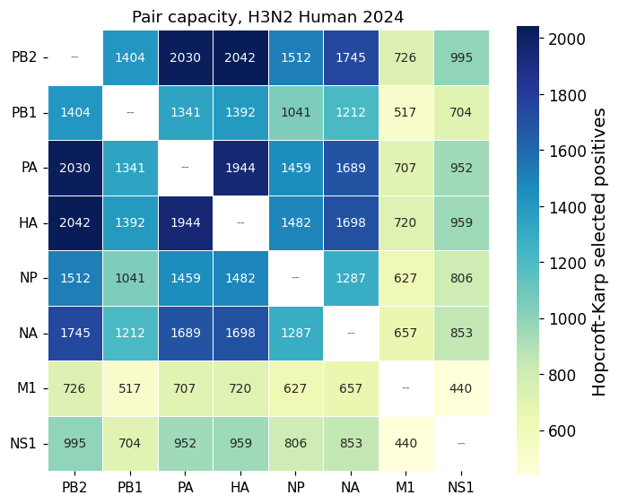
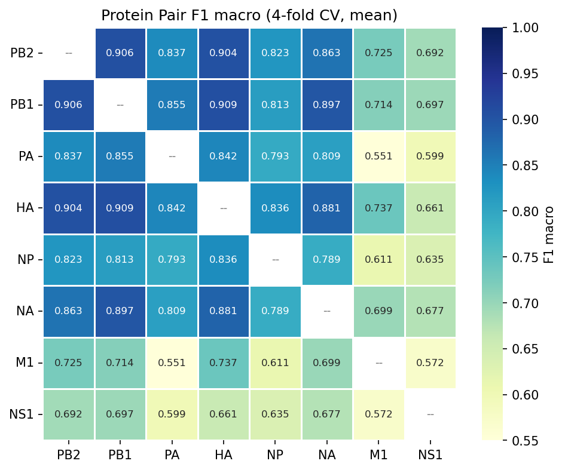
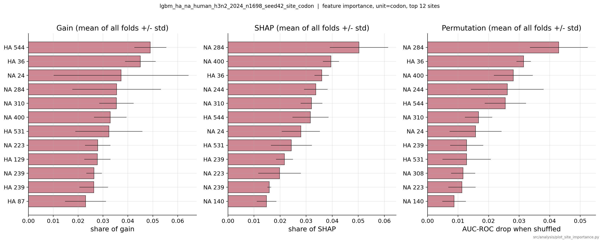
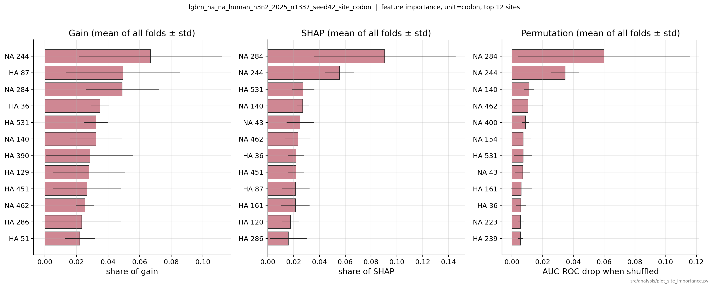
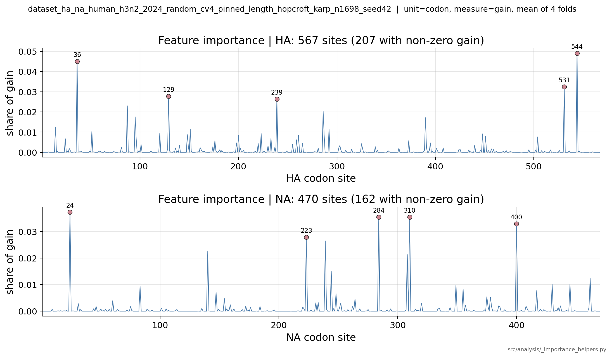
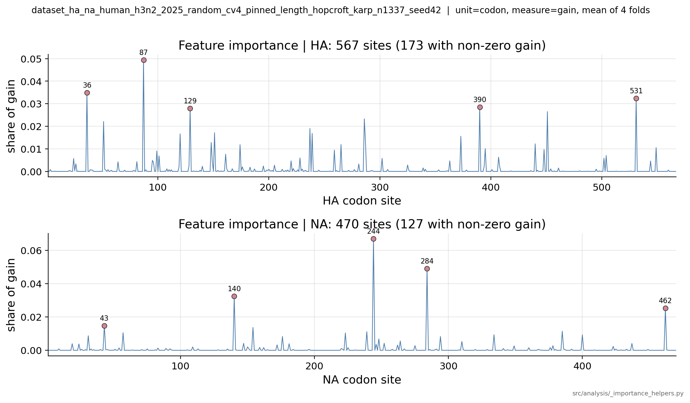
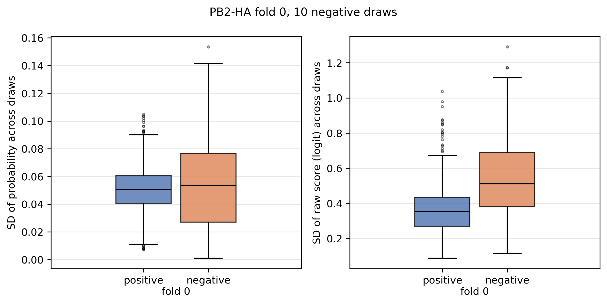
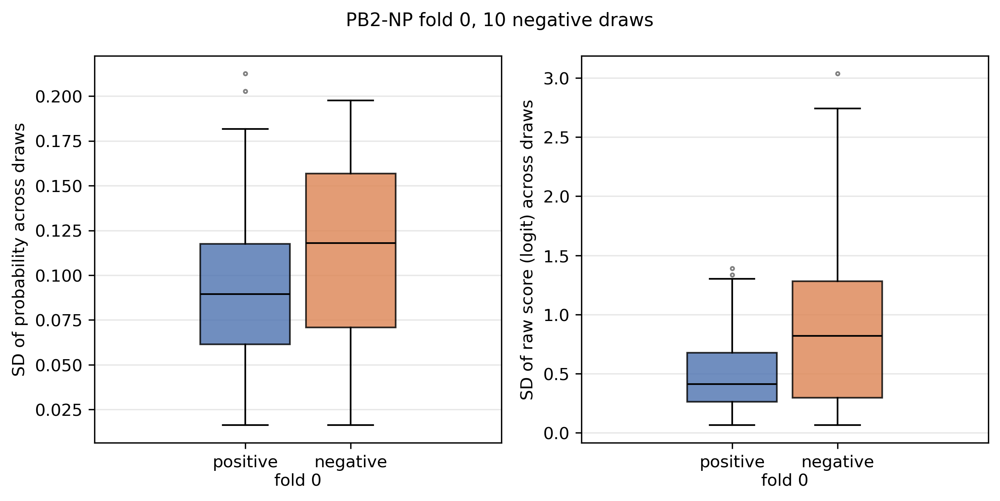

# Cross-year site feature importance, 28-pairs, and aligned CDS features

**Status: IN PROGRESS**

## Goal

Address questions raised following `docs/results/2026-09-08_h3n2_2024_progress_report.md` (focus on Human-H3N2-2024):

1. `DONE`. Measure each of the 28 schema pairs *native* `HK selected` positive count in Human-H3N2-2024,
while considering only complete CDS at pinned lengths.
2. `DONE`. Train and evaluate LightGBM for the 28 schema pairs in Human-H3N2-2024, using each pair’s
native `HK selected` positives and a 1:1 ratio of balanced-usage negatives in each fold.
3. Do GenSLM embedded codons perform better as features for LightGBM than raw codon features?
4. `DONE`. Do models trained separately on Human-H3N2-2024 and Human-H3N2-2025 rely on similar HA and NA
codon sites?
5. Explore how complete NS1 sequences from Human-H3N2-2024 align, retaining all observed
lengths. Inspect which positions correspond and where the alignment places gaps. Record the
findings in `docs/results/2026-09-07_cds_length_survey.md` before expanding the population.
6. `DONE`. When we redraw the negative training pairs, do predictions change more for positive or
negative test pairs?

## Scope

- Population (metadata filters): Human-H3N2-2024.
- 8 major Proteins: PB2, PB1, PA, HA, NP, NA, M1, NS1.
- Positive pairs: observed same-isolate pairs, deduplicated by `nt_cds` pair key.
- Positive selection: Hopcroft-Karp, so each retained CDS occurs at most once in each slot.
- Splitting: 4-fold random CV with balanced-usage negatives generated in each fold.
- Features: per-site codons and GenSLM embedded codons. Nucleotide (nt) 6-mers and amino-acids
  (aa) will be added later for the full analysis.
- Feature importance measure: fold-averaged LightGBM gain, SHAP, test set permutation.
- Experiments 1-4 should use the same pin table (below). This keeps the feature dimensions and site indices consistent across runs. It does not establish that corresponding positions are homologous, which needs separate alignment validation or entropy analysis.

| Segment ID | protein | pin (nt) | source |
| --- |---|---:|---|
| 1 | PB2 | 2,280 | `conf/virus/flu.yaml` |
| 2 | PB1 | 2,277 | bundle override |
| 3 | PA | 2,151 | `conf/virus/flu.yaml` |
| 4 | HA | 1,701 | `conf/virus/flu.yaml` |
| 5 | NP | 1,497 | `conf/virus/flu.yaml` |
| 6 | NA | 1,410 | `conf/virus/flu.yaml` |
| 7 | M1 | 759 | `conf/virus/flu.yaml` |
| 8 | NS1 | 693 | bundle override |

Detailed CDS length analysis: `results/docs/results/2026-09-07_cds_length_survey.md`.

- PB1 and NS1 are not pinned in `conf/virus/flu.yaml` because no single length works across
all populations covered by that shared configuration.
- NS1: Human-H3N2 uses a 693-nt pin. This is the modal complete-CDS length in every year from
2015 through 2025. Other populations have different dominant lengths; for example, H1N1 is
dominated by 660-nt records in the corpus.
- PB1: Within Human-H3N2, the modal complete-CDS length is 2,274 nt from 2015 through 2023.
However, its becomes 2,277 nt in 2024 and 2025. Both lengths are common in 2023, so no single
PB1 pin works across the full period.
- The Human-H3N2 experiments therefore add PB1 and NS1 pins through a bundle-level override:
2,277 nt for PB1 and 693 nt for NS1.
- Putting these population-specific values in the shared file could cause check_cds_length
to fail when a run uses a population with a different modal length.
- How many isolates each pin retains by year is reported under “Pin reach by year” in
`docs/results/2026-09-07_cds_length_survey.md`.

## Caveats

- For Human-H3N2-2024, only 55.3% of isolates have a complete PB1 (alignment cannot fix that).
See `docs/results/2026-09-07_cds_length_survey.md` section "Results: Human-H3N2-2024".
- From Experiment 1, the `HK selected` positives count ranges 440 to 2,042 across the 28 pairs
for Human-H3N2-2024, with `M1` or `NS1` involved in the lowest counts.

## Dataset checks every experiment must pass

- No generated negative is an observed positive from the pair universe (block conflicting negatives).
- Before Experiment 2 trains, each production dataset reproduces the `Eligible isolates`, `Unique positives`, `Unique slot-A`, `Unique slot-B` and `HK selected` counts its pair has in Experiment 1's `pair_capacity.csv`.
- Where feature importance is computed, every importance row can be traced to a model run, fold, protein, and site.

## Experiment 1: 28-pair capacity audit — DONE (2026-09-16)

### Question

Measure each of the 28 schema pairs *native* `HK selected` positive count in Human-H3N2-2024,
while considering only complete CDS at pinned lengths.

### Methods

Methods and discussion in `docs/results/2026-09-08_cds_pair_capacity.md`; per-protein
completeness and the length pins in `docs/results/2026-09-07_cds_length_survey.md`.

- Population: Human-H3N2-2024.
- Each pair uses its own eligible isolates. An isolate needs the pair's two
  proteins as a complete CDS at the pinned length.
- The table in Scope shows the length pins.

```
python -m src.analysis.summarize_pair_capacity \
  --config_bundle flu_8_major_proteins_human_h3n2_2024_pinned_length \
  --proteins PB2 PB1 PA HA NP NA M1 NS1 \
  --out_dir results/flu/July_2025/pair_capacity_8_proteins
```

### Results

Transcribed from `docs/results/2026-09-08_cds_pair_capacity.md`.



- `Pair ID` — the two segment numbers, so PB2-HA is `1-4`.
- `Eligible isolates` — isolates carrying both of the pair's proteins as complete CDS at the pinned length.
- `Unique positives` — observed same-isolate pairs after `nt_cds` pair-key deduplication.
- `Unique slot-A` / `Unique slot-B` — unique sequences on each side of those positives.
- `HK selected` — positives kept by Hopcroft-Karp, so no sequence is used twice in either slot.
- `HK share` = `HK selected` / `Unique positives`. It runs from 22.9% (PA-M1) to 59.8% (PB2-PB1, PB1-HA).

| Pair ID | Schema pair | Eligible isolates | Unique positives | Unique slot-A | Unique slot-B | HK selected | HK share |
|---|---|---:|---:|---:|---:|---:|---:|
| 1-2 | PB2-PB1 | 2,945 | 2,349 | 1,788 | 1,790 | 1,404 | 59.8% |
| 1-3 | PB2-PA | 5,324 | 3,837 | 2,808 | 2,712 | 2,030 | 52.9% |
| 1-4 | PB2-HA | 5,329 | 3,796 | 2,810 | 2,681 | 2,042 | 53.8% |
| 1-5 | PB2-NP | 5,318 | 3,484 | 2,800 | 1,830 | 1,512 | 43.4% |
| 1-6 | PB2-NA | 5,167 | 3,532 | 2,745 | 2,203 | 1,745 | 49.4% |
| 1-7 | PB2-M1 | 5,332 | 3,128 | 2,813 | 812 | 726 | 23.2% |
| 1-8 | PB2-NS1 | 5,313 | 3,204 | 2,800 | 1,120 | 995 | 31.1% |
| 2-3 | PB1-PA | 2,939 | 2,332 | 1,786 | 1,710 | 1,341 | 57.5% |
| 2-4 | PB1-HA | 2,945 | 2,327 | 1,790 | 1,756 | 1,392 | 59.8% |
| 2-5 | PB1-NP | 2,942 | 2,162 | 1,787 | 1,227 | 1,041 | 48.1% |
| 2-6 | PB1-NA | 2,939 | 2,237 | 1,786 | 1,480 | 1,212 | 54.2% |
| 2-7 | PB1-M1 | 2,945 | 1,992 | 1,790 | 582 | 517 | 26.0% |
| 2-8 | PB1-NS1 | 2,937 | 2,029 | 1,788 | 781 | 704 | 34.7% |
| 3-4 | PA-HA | 5,329 | 3,805 | 2,711 | 2,682 | 1,944 | 51.1% |
| 3-5 | PA-NP | 5,318 | 3,455 | 2,703 | 1,832 | 1,459 | 42.2% |
| 3-6 | PA-NA | 5,167 | 3,520 | 2,649 | 2,202 | 1,689 | 48.0% |
| 3-7 | PA-M1 | 5,335 | 3,082 | 2,716 | 812 | 707 | 22.9% |
| 3-8 | PA-NS1 | 5,315 | 3,214 | 2,705 | 1,121 | 952 | 29.6% |
| 4-5 | HA-NP | 5,323 | 3,382 | 2,673 | 1,830 | 1,482 | 43.8% |
| 4-6 | HA-NA | 5,173 | 3,466 | 2,634 | 2,203 | 1,698 | 49.0% |
| 4-7 | HA-M1 | 5,338 | 3,018 | 2,686 | 811 | 720 | 23.9% |
| 4-8 | HA-NS1 | 5,318 | 3,151 | 2,676 | 1,119 | 959 | 30.4% |
| 5-6 | NP-NA | 5,162 | 3,091 | 1,794 | 2,197 | 1,287 | 41.6% |
| 5-7 | NP-M1 | 5,326 | 2,356 | 1,833 | 808 | 627 | 26.6% |
| 5-8 | NP-NS1 | 5,307 | 2,540 | 1,824 | 1,114 | 806 | 31.7% |
| 6-7 | NA-M1 | 5,176 | 2,620 | 2,206 | 800 | 657 | 25.1% |
| 6-8 | NA-NS1 | 5,156 | 2,794 | 2,196 | 1,092 | 853 | 30.5% |
| 7-8 | M1-NS1 | 5,323 | 1,840 | 806 | 1,122 | 440 | 23.9% |

What the later experiments need from this:

- **Experiment 2** trains on the `HK selected` column: 440 (M1-NS1) to 2,042 (PB2-HA).
  The 13 pairs containing M1 or NS1 hold the 13 lowest counts (M1 or NS1 supply the fewest unique
  sequences).
- **Experiment 3** runs GenSLM on the same data as Experiment 2 (same
  positives and negatives, sequences and folds). Varying CDS length can be explored later, but it would
  not recover PB1's 44.7%, which stems from incomplete records rather than the pin.
- **Experiment 5** does not draw on this section. It addresses complete CDS at more than one
  length, measured in `docs/results/2026-09-07_cds_length_survey.md`.

#### Decision for Experiments 2 and 3

All 28 schema pairs proceed with their native `HK selected` positives. They are not downsampled to
the M1-NS1 floor of 440.


## Experiment 2: pinned-length 28-pairs screen — DONE (2026-10-07 balanced rerun)

### Question

Train and evaluate LightGBM for all 28 schema pairs in Human-H3N2-2024, using each pair’s
native `HK selected` positives and a 1:1 ratio of balanced-usage negatives in each fold.

### Methods

- The pinned lengths are listed in Scope above. Each pair uses the `HK selected` positive count from
  Experiment 1. Per-protein CDS completeness is reported in `docs/results/2026-09-07_cds_length_survey.md`
- One dataset per schema pair, built from `conf/bundles/flu_28p_codon_{pair}.yaml`. The 28
  children yaml files inherit the master, `conf/bundles/flu_28p_human_h3n2_2024_site_codon.yaml`,
  and each sets only `schema_pair`, so every pair runs under identical rules: Human-H3N2-2024,
  complete CDS at the pinned length, the `nt_cds` pair key, Hopcroft-Karp to select positives (the
  `HK selected` positives set), random 4-fold CV.
- Each schema pair uses its native `HK selected` positives, ranging from 440 for M1-NS1 to 2,042 for
  PB2-HA (i.e., datasets are not downsampled to a common size, as decided at the end of Experiment 1).
- The negatives are drawn with `negative_scope: balanced` at a 1:1 ratio. Each sequence appears
  once per slot in each split's negatives, as in its positives.
- A generated negative is a pair not observed in the pair universe. It is not evidence that the pair
  is biologically incompatible.
- The model is LightGBM with row sampling (`subsample: 0.7`, `subsample_freq: 1`) at a 0.5
  threshold (test probabilities are saved). Row sampling lets trees grow when balanced
  sequence-use counts make every individual site marginally equal across classes.
- With balanced test folds, a classifier predicting each class randomly has expected F1 macro near 0.5.
- Features are one ordinal column per codon position, for both slots concatenated. The width is
  the sum of the two proteins' codon counts (484 for M1-NS1 to 1,519 for PB2-PB1).
- Before training, all 28 datasets reproduced their `Eligible isolates`, `Unique positives`,
  `Unique slot-A`, `Unique slot-B` and `HK selected` counts from Experiment 1's
  `pair_capacity.csv`. The audit also verified one negative use per sequence per slot and no
  observed pair among negatives (`src/analysis/audit_pair_datasets.py`, 28 passed, 0 failed).
- All positive pair keys and their fold, split, and row order match the 2026-09-20 screen.
- 112 models trained (28 pairs x 4 folds).

```
python scripts/run_allpairs_datasets.py \
  --dataset-prefix exp2_28p_codon_balanced_20261007_180037_ --max-workers 4

python -m src.analysis.audit_pair_datasets \
  --runs_glob 'exp2_28p_codon_balanced_20261007_180037_*' --expect_pairs 28

python scripts/run_allpairs_baselines.py \
  --bundle_prefix flu_28p_codon_ \
  --dataset_prefix exp2_28p_codon_balanced_20261007_180037_ \
  --baseline lgbm --cv_dir_bundle 'flu_28p_{pair}_codon_balanced' --max_workers 8

python -m src.analysis.aggregate_allpairs_results --tag codon_balanced \
  --timestamp 20261007_181555 \
  --output_dir results/flu/July_2025/all_pairs_human_h3n2_2024_codon_balanced_20261007_181555
```

### Results



- Mean ± STD across 4 folds.
- Pairs are ranked by mean F1 macro.
- All the scores are in
  `results/flu/July_2025/all_pairs_human_h3n2_2024_codon_balanced_20261007_181555/allpairs_summary.csv`.


| Rank | Schema pair | HK selected | Features | F1 macro | AUC-ROC | Precision | Recall |
|---:|---|---:|---:|---:|---:|---:|---:|
| 1 | PB1-HA | 1,392 | 1,326 | 0.909 ± 0.016 | 0.945 ± 0.008 | 0.871 ± 0.015 | 0.960 ± 0.014 |
| 2 | PB2-PB1 | 1,404 | 1,519 | 0.906 ± 0.010 | 0.943 ± 0.005 | 0.874 ± 0.010 | 0.950 ± 0.015 |
| 3 | PB2-HA | 2,042 | 1,327 | 0.904 ± 0.007 | 0.948 ± 0.005 | 0.863 ± 0.006 | 0.961 ± 0.009 |
| 4 | PB1-NA | 1,212 | 1,229 | 0.897 ± 0.014 | 0.935 ± 0.017 | 0.861 ± 0.025 | 0.947 ± 0.006 |
| 5 | HA-NA | 1,698 | 1,037 | 0.881 ± 0.023 | 0.931 ± 0.006 | 0.843 ± 0.012 | 0.938 ± 0.038 |
| 6 | PB2-NA | 1,745 | 1,230 | 0.863 ± 0.014 | 0.924 ± 0.005 | 0.819 ± 0.017 | 0.935 ± 0.017 |
| 7 | PB1-PA | 1,341 | 1,476 | 0.855 ± 0.018 | 0.922 ± 0.017 | 0.808 ± 0.026 | 0.936 ± 0.012 |
| 8 | PA-HA | 1,944 | 1,284 | 0.842 ± 0.008 | 0.917 ± 0.007 | 0.799 ± 0.018 | 0.918 ± 0.015 |
| 9 | PB2-PA | 2,030 | 1,477 | 0.837 ± 0.014 | 0.917 ± 0.008 | 0.793 ± 0.022 | 0.916 ± 0.015 |
| 10 | HA-NP | 1,482 | 1,066 | 0.836 ± 0.008 | 0.912 ± 0.008 | 0.788 ± 0.015 | 0.924 ± 0.013 |
| 11 | PB2-NP | 1,512 | 1,259 | 0.823 ± 0.019 | 0.901 ± 0.021 | 0.761 ± 0.025 | 0.951 ± 0.008 |
| 12 | PB1-NP | 1,041 | 1,258 | 0.813 ± 0.026 | 0.890 ± 0.023 | 0.763 ± 0.021 | 0.912 ± 0.030 |
| 13 | PA-NA | 1,689 | 1,187 | 0.809 ± 0.029 | 0.894 ± 0.019 | 0.764 ± 0.030 | 0.901 ± 0.045 |
| 14 | PA-NP | 1,459 | 1,216 | 0.793 ± 0.018 | 0.884 ± 0.018 | 0.738 ± 0.020 | 0.923 ± 0.013 |
| 15 | NP-NA | 1,287 | 969 | 0.789 ± 0.007 | 0.873 ± 0.012 | 0.733 ± 0.009 | 0.921 ± 0.010 |
| 16 | HA-M1 | 720 | 820 | 0.737 ± 0.036 | 0.812 ± 0.028 | 0.695 ± 0.031 | 0.857 ± 0.036 |
| 17 | PB2-M1 | 726 | 1,013 | 0.725 ± 0.032 | 0.808 ± 0.046 | 0.679 ± 0.023 | 0.880 ± 0.079 |
| 18 | PB1-M1 | 517 | 1,012 | 0.714 ± 0.033 | 0.809 ± 0.019 | 0.665 ± 0.031 | 0.915 ± 0.028 |
| 19 | NA-M1 | 657 | 723 | 0.699 ± 0.036 | 0.781 ± 0.042 | 0.655 ± 0.027 | 0.878 ± 0.034 |
| 20 | PB1-NS1 | 704 | 990 | 0.697 ± 0.034 | 0.795 ± 0.035 | 0.659 ± 0.022 | 0.839 ± 0.076 |
| 21 | PB2-NS1 | 995 | 991 | 0.692 ± 0.031 | 0.781 ± 0.035 | 0.653 ± 0.024 | 0.854 ± 0.032 |
| 22 | NA-NS1 | 853 | 701 | 0.677 ± 0.066 | 0.769 ± 0.069 | 0.644 ± 0.046 | 0.828 ± 0.134 |
| 23 | HA-NS1 | 959 | 798 | 0.661 ± 0.061 | 0.739 ± 0.064 | 0.628 ± 0.045 | 0.844 ± 0.055 |
| 24 | NP-NS1 | 806 | 730 | 0.635 ± 0.032 | 0.730 ± 0.038 | 0.607 ± 0.023 | 0.854 ± 0.043 |
| 25 | NP-M1 | 627 | 752 | 0.611 ± 0.052 | 0.683 ± 0.033 | 0.602 ± 0.037 | 0.759 ± 0.087 |
| 26 | PA-NS1 | 952 | 948 | 0.599 ± 0.043 | 0.710 ± 0.025 | 0.586 ± 0.028 | 0.820 ± 0.054 |
| 27 | M1-NS1 | 440 | 484 | 0.572 ± 0.076 | 0.681 ± 0.042 | 0.574 ± 0.037 | 0.889 ± 0.045 |
| 28 | PA-M1 | 707 | 970 | 0.551 ± 0.055 | 0.667 ± 0.030 | 0.558 ± 0.029 | 0.859 ± 0.030 |


- F1 macro ranges [0.551, 0.909], with a median of 0.791. All pairs score above 0.5.
- Across the 28 pairs, F1 macro correlates with `HK selected` at $\rho$=0.770 and with feature width at $\rho$=0.853 ($\rho$: Spearman correlation).
- The 13 pairs containing M1 or NS1 have the smallest `HK selected` and the lowest F1 scores.
- Among the other 15 pairs, the correlations are $\rho$=0.146 with `HK selected` and $\rho$=0.529 with feature width.
- The pairs differ in several ways, so these correlation results do not establish that either `HK selected` or feature width limits performance.
- Recall > Precision in all 28 pairs, so the model over-predicts the positive class at
  0.5 threshold.
- Relative to the 2026-09-20 `within_fold` screen, the median pair-level F1 macro change is
  −0.005. PB2-HA changes from 0.909 to 0.904, and PB2-NP from 0.840 to 0.823. Both the negative
  sampler and LightGBM row sampling changed, so these differences do not isolate either effect.
  The earlier table and UMAPs remain in `results/flu/July_2025/all_pairs_human_h3n2_2024_codon/`
  and `docs/results/figs/`.

Limitations:

- One population: Human-H3N2-2024.
- Only 4 CV folds.
- The datasets across the schema pairs do not necessarily share the same isolates.

What the later experiments need from this:

- **Experiment 3** compares GenSLM codon embeddings with per-site codon features. For each schema pair included in Experiment 3, both feature types should use the same dataset whenever possible, and their F1 macro scores should be compared.
- **Experiment 5** does not draw on this section.


## Experiment 3: GenSLM embedded codons as features for LightGBM

### Question

Do GenSLM embedded codons perform better as features for LightGBM than raw codon features?

### Methods

GenSLM embeddings are also a route to sequences of varying length, since they do not need one
column per pinned position. This experiment holds the length pinned and changes only the feature
representation; varying length is a later question.

1. Compute and cache GenSLM embeddings for all unique complete CDS codons.
2. Start with CV training on HA-NA, Human-H3N2-2024. Reuse Experiment 2's built dataset rather
   than rebuilding it, so the 1,698 `HK selected` positives and the 4 fold assignments are
   identical and the only difference from the raw-codon run is the feature representation.
3. Expand to the 4 schema pairs as in `2026-09-08_h3n2_2024_progress_report.md`: HA-NA, PB2-PA,
   PB2-NA, PA-HA, reusing Experiment 2's datasets for each.
4. Optional. All 28 pairs, again on Experiment 2's datasets.

### Results

1. Generate a table similar to the table under Results in 2026-09-08_h3n2_2024_progress_report.md,
   with the same columns and one row per pair per feature type, so GenSLM sits beside the
   per-site codon scores from Experiment 2.

2. If step 4 runs, plot the symmetric 8 x 8 F1 macro heatmap, as in Experiment 2.


## Experiment 4: cross-year HA-NA importance — DONE (2026-09-15)

### Question

Do models trained separately on Human-H3N2-2024 and Human-H3N2-2025 rely on similar HA and NA
codon sites?

### Methods

- For the Human-H3N2-2024 analysis, we used `conf/bundles/flu_ha_na_human_h3n2_2024_random_cv4_pinned_length_hopcroft_karp.yaml` and the saved `resolved_config.yaml` from its earlier codon runs.
- For the Human-H3N2-2025 analysis, we used `conf/bundles/flu_ha_na_human_h3n2_2025_random_cv4_pinned_length_hopcroft_karp.yaml` where only the year is different and otherwise reused the same settings.
- Both analyses kept all their `HK selected` positives: 1,698 in 2024 and 1,337 in 2025 (i.e., we didn't downsample to the same size).
- The July 2025 corpus contains only a partial 2025 season.
- `src/analysis/plot_site_importance.py` computed gain, SHAP, and permutation importance. The cross-year ranking uses fold-averaged, normalized gain. The comparison was run 3 ways:
  - `combined`: HA and NA compete for the same top-N positions;
  - `HA`: sites are ranked within HA only;
  - `NA`: sites are ranked within NA only.

Both datasets contain complete sequences at the same pins and use the same feature coordinates:
567 HA sites and 470 NA sites.

### Results

The barplots show gain, SHAP, and permutation importance for Human-H3N2-2024 and
Human-H3N2-2025.





The gain traces show where gain falls along HA and NA.





The division of gain between the two proteins changed modestly, while its concentration in the
combined top-25 sites was similar.

| year | gain by protein | gain in combined top-25 sites |
|---|---|---:|
| 2024 | HA 55.5%; NA 44.5% | 59.1% |
| 2025 | HA 60.4%; NA 39.6% | 60.6% |

The two years share 13 of their combined top-25 sites, 15 of the top-25 HA sites, and 13 of the
top-25 NA sites. All three overlaps were much larger than expected under the varying-site null.

The null comparison treats a site as eligible when it has more than one observed value
(`n_values > 1`). If `V_2024` and `V_2025` are the eligible sets, two independent random top-N
lists have expected overlap
`|V_2024 ∩ V_2025| × (N / |V_2024|) × (N / |V_2025|)`.
This is a descriptive baseline, not a significance test: it treats eligible sites as independent
and equally likely to be selected, which is not true for correlated sites. In the combined row
below, `V_2024 ∩ V_2025` is "eligible in both" and each `V` is that year's "eligible" column, so
the expected overlap at N = 25 is `931 × (25/987) × (25/946) = 0.62`.

| ranking | eligible in 2024 | eligible in 2025 | eligible in both | shared top 25 | shared/N | expected | enrichment |
|---|---:|---:|---:|---:|---:|---:|---:|
| combined | 987 | 946 | 931 | 13 | 52% | 0.62 | 20.9x |
| HA | 542 | 519 | 511 | 15 | 60% | 1.14 | 13.2x |
| NA | 445 | 427 | 420 | 13 | 52% | 1.38 | 9.4x |

The complete top-10-to-top-50 comparison is in
`results/flu/July_2025/cross_year_site_importance/ha_na_human_h3n2_2024_vs_2025/site_importance_comparison.csv`.

- The leading sites therefore recur across the two annual fits more often than expected if varying
sites were selected uniformly.
- The comparison does not control for the smaller 2025
population, the partial 2025 season, or correlation among sites.
- `TODO`: repeast similar analysis with SHAP and permutation.


## Experiment 5: NS1 protein alignment pilot

### Goal

Align the proteins recorded for complete Human-H3N2-2024 NS1 CDS, retaining every observed
CDS length. Inspect the protein-alignment columns and gap symbols (`-`) in
MAFFT's output as an estimate of which positions correspond.

See [Alignment in the glossary](../methods/glossary.md#per-site-features) for the definition
and the distinction between an estimated correspondence and an established evolutionary history.

### Methods

1. Select complete NS1 CDS from Human-H3N2-2024, retaining all observed lengths.
2. Use `prot_seq` from `cds_dna_final.parquet`. For every selected unique CDS, check that it
   matches `cds_utils.translate_dna(cds_dna_seq)`, ends with exactly one `*`, has no internal
   `*`, and that the CDS length is three times the length of `prot_seq`, including its `*`.
   Stop if a check fails. Remove the terminal `*` only from the protein sent
   to MAFFT; keep the original CDS unchanged. With the options used here,
   [MAFFT would also remove `*`](https://mafft.cbrc.jp/alignment/software/anysymbol.html)
   by default. Removing it ourselves records the exact input sequence and lets us
   compare it directly with the gap-stripped output.
   Keep `X` symbols and report how many isolates, unique CDS and unique proteins contain them,
   by CDS length. Name each FASTA record by its original `prot_hash`, which hashes the
   protein with its terminal `*` marker.
   An `X` means the original codon does not resolve to one amino acid; it does not erase that
   codon or create a gap. Because `X` gives the aligner less information about that position,
   inspect any uncertain gap placements near it.
3. Align the unique protein sequences with MAFFT using `--auto`. Record the tool version,
   full command, selected alignment strategy and input sequence hashes. Save the MAFFT log.
   Keep a mapping from each protein to its original CDS records so that synonymous CDS
   variants remain available.
4. Confirm that removing `-` from each aligned protein recovers the exact protein
   sequence sent to MAFFT, which has no terminal `*` marker.
5. Inspect the alignment, including sequences of the same length and examples of each
   observed CDS length. Examine where gaps fall and note uncertain placements.

If a placement needs further checking, optionally run a second MAFFT strategy and compare
the affected regions. Agreement between strategies does not establish that a placement is correct.

A `-` in the protein alignment, an `X` in a protein sequence and bases absent from a
truncated record are different. This pilot uses complete CDS; alignment cannot recover
bases absent from a truncated record.

### Outputs

The pilot artifacts are under
`results/flu/July_2025/cds_alignment_pilot/Human-H3N2-2024/NS1/`. The sequence examples and
interpretation are in the [NS1 protein alignment pilot results](../results/2026-11-09_protein_alignment.md#ns1-on-human-h3n2-2024-task-1-population).

### Progress

**Step 1.** Implemented and run on 2026-11-05.

| CDS length | Isolates | Unique CDS | Unique proteins |
|---|---:|---:|---:|
| 654 nt | 4 | 3 | 3 |
| 660 nt | 9 | 7 | 6 |
| 693 nt | 5,324 | 1,122 | 551 |
| Total | 5,337 | 1,132 | 560 |

**Step 2.** Implemented and run on 2026-11-05. All 1,132 unique CDS passed the translation,
terminal-stop, length and protein-hash checks. The FASTA contains 560 unique proteins without
their terminal `*`.

| CDS length | Isolates with `X` | Unique CDS with `X` | Unique proteins with `X` |
|---|---:|---:|---:|
| 654 nt | 0 | 0 | 0 |
| 660 nt | 0 | 0 | 0 |
| 693 nt | 48 | 48 | 48 |

**Step 3.** Implemented and run on 2026-11-05. We ran MAFFT 7.526 on all 560
proteins with `--auto`; it selected the FFT-NS-2 strategy. The protein
alignment has 230 columns. The terminal CDS stop codons were not aligned.

**Step 4.** Implemented and run on 2026-11-05. All 560 aligned protein IDs matched the inputs.
Removing `-` recovered the exact protein sequence sent to MAFFT for every protein.

**Step 5.** Implemented and run on 2026-11-05. Each CDS includes a terminal stop codon.
The protein sent to MAFFT lacked its terminal `*` marker; the original CDS was unchanged.
The table counts `-` symbols per protein in the 230-column alignment. Every protein
from a given CDS length has the gap columns shown.

| CDS length | Codons including stop | Protein symbols sent to MAFFT | `-` symbols | Gap columns |
|---|---:|---:|---:|---|
| 693 nt | 231 | 230 | 0 | — |
| 660 nt | 220 | 219 | 11 | 220–230, trailing |
| 654 nt | 218 | 217 | 13 | 218–230, trailing |

There are no internal gaps.

### Next step

The [downstream contig check](../results/2026-11-09_protein_alignment.md#downstream-contig-check)
supports mapping the 654-nt CDS stop codon to column 218 and the 660-nt CDS
stop codon to column 220, opposite the same-numbered codons in the 693-nt
reference. Because the terminal `*` markers were removed, the protein alignment
alone cannot place these stop codons.

**Proposed codon feature mapping for this pilot:** put each original sense codon in
its protein-alignment column. Put the CDS's terminal stop codon in the next column
after its last aligned amino acid. Add one column after the 230 protein columns
for the 693-nt stop codon. MAFFT aligned the protein sequences without their terminal
`*` markers:

```text
Protein column:  1–217   218   219   220–230
693-nt CDS:      aa...   aa    aa    aa...aa
660-nt CDS:      aa...   aa    aa    - ... -
654-nt CDS:      aa...   -     -     - ... -
```

Here `aa` stands for a non-gap protein symbol (an amino acid or `X`);
`-` means a protein-alignment gap.

In the proposed codon feature table, the first trailing protein-alignment gap
column would hold that CDS's stop codon. The 693-nt stop would occupy the added
column 231:

```text
Feature column:  1–217          218       219        220        221–230     231
693-nt CDS:      sense codons   CAG       AAA        CGG        sense       TGA
660-nt CDS:      sense codons   sense     sense      TGA        AFTER_STOP  AFTER_STOP
654-nt CDS:      sense codons   TAG       AFTER_STOP AFTER_STOP AFTER_STOP  AFTER_STOP
                                ^                    ^                      ^
                            654-nt stop         660-nt stop            693-nt stop
```

The `CAG`, `AAA`, `CGG` and `TGA` shown in the 693-nt row are from the most
frequent 693-nt CDS; other 693-nt CDS can differ. Give every empty column
*after* a sequence's stop the `AFTER_STOP` state. Give any other empty column
the `GAP` state. These states are defined in the
[glossary](../methods/glossary.md#per-site-features). This pilot has no gaps
between the first and last aligned protein symbols. Under this proposal, it would
have no `GAP` feature values, and `AFTER_STOP` would give the same feature layout
as filling at the end. The CDS is
the feature source, so do not use post-stop bases from the contig as codon
features.

If another alignment has an internal gap, it would use `GAP` rather than
`AFTER_STOP` at that position:

```text
Protein column:  1   2   3   4   5
Aligned protein: M   K   -   V   G
Feature column:  1   2   3   4   5   6
Codon features:  ATG AAA GAP GTT GGT TGA
```

Before using this mapping in a model, check that removing `GAP` and `AFTER_STOP`
recovers every original CDS codon in order, that each sequence has exactly one
terminal stop, and that its sense codons translate to the aligned protein after
gaps are removed. Check that 693-nt sequences reproduce their current codon
codes. The protein alignment audit below does not implement this codon
feature mapping. HA and NA across subtypes can follow after their own checks.

For later model evaluation, build columns from training sequences and map
validation and test sequences into those fixed columns, with an explicit rule
for new insertions.

### NS1 protein alignment for Human+Pig-H1N1+H3N2-yr2010-2025 — DROPPED (2026-11-10)

Filters: host `[Human, Pig]`, subtype `[H3N2, H1N1]`, year `2010–2025`
(inclusive). This population was a candidate for Task 2 and is not the one
Task 2 uses; the Task 2 population is covered in the next subsection. The goal
is to see whether complete NS1 proteins can share alignment columns and where
gaps fall.

Select complete NS1 CDS without pinning their length. Count isolates, unique
CDS and unique proteins by length and by host, subtype and year. Align unique
proteins with MAFFT `--auto`, check that removing gaps recovers every input,
and inspect gap patterns. For each alignment column, count how many proteins
and isolates have a non-gap symbol (an amino acid or `X`) in it. MAFFT did not
receive terminal `*` markers, so its output cannot place CDS stop codons.
The alignment alone also cannot establish that each column represents the
same biological position.
Decide codon feature columns only after reviewing these results and any unusual
gap placements.
Decide whether to keep the 56 complete records outside the 654-, 660-, 672-
and 693-nt forms in a first feature set. Record any exclusions by host,
subtype and year.

This population was dropped on 2026-11-10 because the Task 2 population
replaced it. Its section in `docs/results/2026-11-09_protein_alignment.md` and
its outputs under
`results/flu/July_2025/cds_alignment_pilot/Human+Pig-H1N1+H3N2-yr2010-2025/`
were both removed, so the numbers above are no longer backed by saved files.
`Swine` holds exactly one animal name, `Pig`, so this population selected the
same isolates a `Human+Swine` filter would.

### NS1 protein alignment for the Task 2 population — DONE (2026-11-09)

Filters: host `[Human, Swine, Chicken, Duck]`, subtype `[H3N2, H1N1, H5N1]`,
year `2010–2025`. `host` is a host group, so `Duck` covers 54 animal names and
`Chicken` covers 3. This is the population Task 2 uses.

Same 5 steps as the pilot, then `summarize_protein_alignment.py`. Commands used
`--host Human Swine Chicken Duck --hn_subtype H3N2 H1N1 H5N1 --year_range 2010
2025`.

* 60,751 filtered isolates, 60,654 (99.8%) with a complete CDS, 18,107 unique
  CDS, 10,130 unique proteins, 16 CDS lengths, 147 host–subtype–year groups.
* MAFFT 7.526 with `--auto` selected FFT-NS-2 and produced 240 columns. Removing
  `-` recovered every input protein.
* No single pinned length is available. The largest share of unique complete
  sequences is 693 nt at 0.502, then 660 nt at 0.455, against the 0.90 that
  `check_cds_length` needs.
* **The 678-nt form has a 5-codon internal deletion at columns 81–85.** It is
  not a truncated 693-nt form. All 205 of its unique proteins share the pattern,
  over 341 isolates, 340 of them H5N1. This is the first internal gap that many
  sequences share, so it is the first real `GAP` case: the pilot had no internal
  gaps and the previous population had only 3 singleton internal columns.
* A codon feature table needs 241 columns, not 240. The 714-nt form fills every
  protein column, so its stop codon needs one more. The 693-nt and 678-nt forms
  both put their stop codon in column 234, which follows from their difference
  being internal rather than at the end.

The [results](../results/2026-11-09_protein_alignment.md#ns1)
give the length, gap-pattern, host–subtype and year tables. The saved inputs,
alignment, validation, gap report and summaries are under
`results/flu/July_2025/cds_alignment_pilot/Chicken+Duck+Human+Swine-H1N1+H3N2+H5N1-yr2010-2025/NS1/`.

Still to decide before codon features are built: whether to keep the 43 isolates
outside the 654-, 660-, 672-, 678-, 693- and 714-nt forms, and whether to keep
the 3 singleton internal columns 74, 112 and 132. Uncommon length alone does not
establish an error.

## Experiment 6: prediction variation across balanced negative draws — DONE (2026-10-07)

### Question

When we redraw the negative training pairs, do predictions change more for positive or negative test
pairs? Item 3 of `plan-paragraph-10-2-26.pdf` asks whether model-based uncertainty is the same for
both classes. Here, we measure how much predictions vary with the negative draw.

### Methods

- Two schema pairs, PB2-HA and PB2-NP, using the 4 folds of their Experiment 2 balanced datasets
  (`exp2_28p_codon_balanced_20261007_180037_pb2_{ha,np}`).
- In each fold, the training negatives are redrawn 10 times (seeds 42-51) with the balanced negative
  sampler, `balanced_usage_negatives`. One LightGBM model is trained per draw, so 40 models per schema
  pair.
- Fixed across the 10 draws: training positives, validation and test pairs, features, LightGBM
  settings, and model seed. Only the training negatives change.
- Within one draw, each negative pair appears once. Nothing stops the same negative pair from
  appearing in more than one draw.
- Each draw has 1,326-1,327 training negatives for PB2-HA and 982 for PB2-NP. Any two draws of
  the same fold share at most 4 negative pairs (0.4% of 982). Across the 10 draws of a fold, 33-48
  negative pairs appear in two draws, and none appears in three or more.
- For each test pair, we compute the sample SD of its 10 class-1 probabilities and the SD of its 10
  logits (i.e., *raw scores*).
- The table reports, for each fold and class, the median of these per-pair SDs. The boxplots show
  the full distribution of these SDs for fold 0 of each pair.

The first two commands run once per pair (`ha`, `np`) and fold (0-3):

```
python scripts/resample_balanced_train_negatives.py \
  --source-fold data/datasets/flu/July_2025/runs/exp2_28p_codon_balanced_20261007_180037_pb2_ha/fold_0 \
  --output-root data/datasets/flu/July_2025/runs/exp6_negative_redraw_20261007_224316_pb2_ha/fold_0 \
  --seeds 42 43 44 45 46 47 48 49 50 51

python scripts/run_balanced_train_redraw.py \
  --dataset-root data/datasets/flu/July_2025/runs/exp6_negative_redraw_20261007_224316_pb2_ha/fold_0 \
  --config-bundle flu_28p_codon_pb2_ha \
  --run-prefix lgbm_exp6_negdraw_20261007_224316_pb2_ha_fold0 \
  --seeds 42 43 44 45 46 47 48 49 50 51

python scripts/analyze_balanced_train_redraw.py --model-root models/flu/July_2025/runs \
  --run-prefix lgbm_exp6_negdraw_20261007_224316_pb2_ha --folds 0 1 2 3 \
  --seeds 42 43 44 45 46 47 48 49 50 51 --label PB2-HA \
  --output-dir results/flu/July_2025/exp6_negative_redraw_20261007_224316_pb2_ha
```

### Results

| pair, fold | F1 macro | prob SD pos / neg | logit SD pos / neg |
|---|---|---|---|
| PB2-HA 0 | 0.898 ± 0.012 | 0.051 / 0.054 | 0.355 / 0.512 |
| PB2-HA 1 | 0.892 ± 0.008 | 0.044 / 0.044 | 0.299 / 0.435 |
| PB2-HA 2 | 0.899 ± 0.007 | 0.044 / 0.047 | 0.291 / 0.393 |
| PB2-HA 3 | 0.902 ± 0.012 | 0.087 / 0.098 | 0.472 / 0.678 |
| PB2-NP 0 | 0.790 ± 0.019 | 0.090 / 0.118 | 0.412 / 0.820 |
| PB2-NP 1 | 0.790 ± 0.008 | 0.041 / 0.051 | 0.175 / 0.309 |
| PB2-NP 2 | 0.842 ± 0.008 | 0.056 / 0.061 | 0.335 / 0.569 |
| PB2-NP 3 | 0.834 ± 0.010 | 0.043 / 0.047 | 0.247 / 0.388 |

How to read the table, using the PB2-HA fold 0 row:

- `pair, fold`: the schema pair and the CV fold. Fold 0 has 10 models (10 draws), and all 10 are
  scored on the same 1,022 test pairs (511 positive, 511 negative).
- `F1 macro` = 0.898 ± 0.012: the mean ± SD of test F1 macro over the 10 models. Here the ± is the
  spread across negative draws, not across folds as in Experiment 2.
- `prob SD pos / neg` = 0.051 / 0.054: each test pair gets one SD, computed from its 10 predicted
  probabilities. 0.051 is the median of these SDs over the 511 positive test pairs, and 0.054 is
  the median over the 511 negative test pairs. For example, one positive pair with an SD of 0.051
  had probabilities from 0.75 to 0.90 across the 10 models.
- `logit SD pos / neg` = 0.355 / 0.512: the same medians, computed on LightGBM's raw score instead
  of the probability. The raw score is `logit(p) = log(p / (1 - p))`.

What the table shows:

- Across draws, the SD of F1 macro is 0.007-0.012 for PB2-HA and 0.008-0.019 for PB2-NP.
- On the raw-score scale, negative test pairs have a higher median SD than positive test pairs in
  all 8 folds.
- On the probability scale, the gap between the classes is small. The negative median SD is higher
  in 7 of 8 folds, and the two medians are equal in PB2-HA fold 1.
<!-- - PB2-HA fold 3 and PB2-NP fold 0 have about twice the probability SD of the other folds of the
  same pair. -->





- Each value in a box is one test pair's SD across the 10 models. Left panel:  probability; Right
  panel: logits.
- Each box spans the IQR of these SDs, and the line is the median.
- In both figures, the negative box is taller than the positive box in both panels. So in fold 0,
  the SDs of negative test pairs are more spread out than those of positive test pairs.
- The figures for folds 1-3, the per-draw probability boxplots (`draw_probability_boxplot.png`),
  the per-pair tables and the per-model metrics are in
  `results/flu/July_2025/exp6_negative_redraw_20261007_224316_pb2_{ha,np}/`.

Limitations:

- Two schema pairs, 4 folds, and 10 draws per fold.
- No significance test was run. The 4 folds of a pair share training data, so they are
  not independent replicates.
- These SDs show how much the redraws move each class's scores in the fold.

## Execution order

1. Build and audit the pinned-length 2024 and 2025 HA-NA datasets. (Experiment 4, DONE)
2. Run the codon cross-year importance comparison. (Experiment 4, DONE)
3. Produce the 2024 eight-protein, 28-pair capacity audit. (Experiment 1, DONE)
4. Build and audit the 28 pinned-length datasets. (Experiment 2, DONE)
5. Run the codon 28-pairs screen and aggregate the results. (Experiment 2, DONE)
6. Pilot balanced training-negative redraws on PB2-HA and PB2-NP, holding each test set fixed.
   (Experiment 6, DONE)
7. Cache the GenSLM codon embeddings, then compare them against raw codon features on HA-NA and
   on the four progress-report pairs. (Experiment 3)
8. Run the NS1 protein alignment pilot on Human-H3N2-2024. (Experiment 5)
9. Review the pilot results before expanding NS1 to the Task 2 population. (Experiment 5)

Steps 4-7 do not depend on the alignment pilot.

## Reproducibility and reporting

Every dataset and model run must record:

- input corpus version and git commit;
- metadata filters;
- CDS completeness and coordinate rules;
- pair-key alphabet and the pair universe used to block negatives;
- positive-selection method and seed;
- fold assignments and `negative_scope`;
- feature representation and alignment version, if used;
- model configuration and output paths.

Keep per-fold data. Do not report only means. Any strict held-out perturbation or masking analysis
must derive its site ranking inside each training fold; a ranking averaged over all folds is
descriptive and must not be used to select features for that same held-out data.

The final report should contain:

1. cross-year HA and NA importance comparisons;
2. the 28-pair capacity and performance matrices;
3. class-conditional prediction variation under training-negative redraws for the piloted pairs;
4. a direct statement of which pairs fail or weaken;
5. GenSLM embedded codons against raw codon features, on the pairs it was run on;
6. the NS1 alignment summary, translation and sequence-recovery checks, and inspected examples;
7. limitations from sampling, partial 2025 coverage, correlated sites, and metadata shortcuts;
8. a recommendation to continue, narrow the scope, or archive the project.

## Code and artifacts

Every script this plan runs, and where its output lands. The purpose column also records what a
caller has to know before using the script, not only what it does.

| item | status | purpose and contract |
|---|---|---|
| `src/analysis/summarize_cds_lengths.py` | built | per-protein CDS completeness and length survey; decides which proteins can be pinned. Results in `docs/results/2026-09-07_cds_length_survey.md` |
| `src/analysis/summarize_pair_capacity.py` | built | the five capacity counts per schema pair, each pair on its own eligible isolates. Writes 6 files to `pair_capacity_8_proteins/`. Results in `docs/results/2026-09-08_cds_pair_capacity.md` |
| `src/embeddings/compute_site_features.py` | built | builds the per-site caches `site_features_{unit}_{PROTEIN}.npz` + `_index.parquet` + `_metadata.json` under `data/embeddings/{virus}/{version}/`. Skips a protein already cached; `--force_recompute` rebuilds. A cache is corpus-wide but pin-specific, so a changed pin needs a rebuild |
| `src/analysis/audit_pair_datasets.py` | built | preflight: checks capacity counts, resolved settings, and balanced negative use and exclusions. Run between building and training |
| `scripts/run_allpairs_datasets.py` | built | builds the 28 child-bundle datasets under one timestamped prefix |
| `scripts/run_allpairs_baselines.py` | built | trains a baseline over every fold of a set of built datasets and aggregates each pair. Writes the CV layout `run_cv_lambda.py` writes, so the aggregators read it unchanged |
| `src/models/train_pair_baselines.py` | built | trains one baseline on one fold directory. The LightGBM path; `train_pair_classifier.py` is the MLP path and cannot run a baseline |
| `src/analysis/aggregate_allpairs_results.py` | built | rolls 28 pairs into one summary and 8x8 heatmaps. Globs `cv_flu_28p_*` under `models/{virus}/{version}/cv_runs/`, reads the pair from the two tokens after `flu_28p_`, and `--tag` selects a variant by the suffix after them |
| `src/analysis/plot_site_importance.py` | built | per-site gain, SHAP and permutation importance. Writes fold-averaged shares with standard deviations, and the pre-average values in `site_importance_{unit}_per_fold.csv` |
| `src/analysis/compare_site_importance_across_years.py` | built | compares two years' per-fold importance tables on shared coordinates |
| `src/analysis/align_proteins.py` | steps 1–6 implemented | selects and validates complete CDS, prepares unique protein sequences, runs MAFFT with `--align_only`, checks exact input recovery with `--validate_only`, and records gap positions with `--inspect_only`. Writes the aligned FASTA, log, input hashes, protein-to-CDS mapping, manifests, validation report and gap locations under `cds_alignment_pilot/<population>/<protein>/` |
| `results/flu/July_2025/cross_year_site_importance/` | written | cross-year tables, audits, and figures |
| `results/flu/July_2025/pair_capacity_8_proteins/` | written | 28-pair capacity audit |
| `results/flu/July_2025/all_pairs_human_h3n2_2024_codon_balanced_20261007_181555/` | written | balanced-negative 28-pair codon summaries and figures |
| `results/flu/July_2025/all_pairs_human_h3n2_2024_codon/` | historical | 2026-09-20 within-fold summaries and figures |
| `results/flu/July_2025/cds_alignment_pilot/` | alignment inspected | `Human-H3N2-2024/NS1/` contains the selection, alignment and validation outputs plus `gap_locations.csv` and `inspection_manifest.json` |
