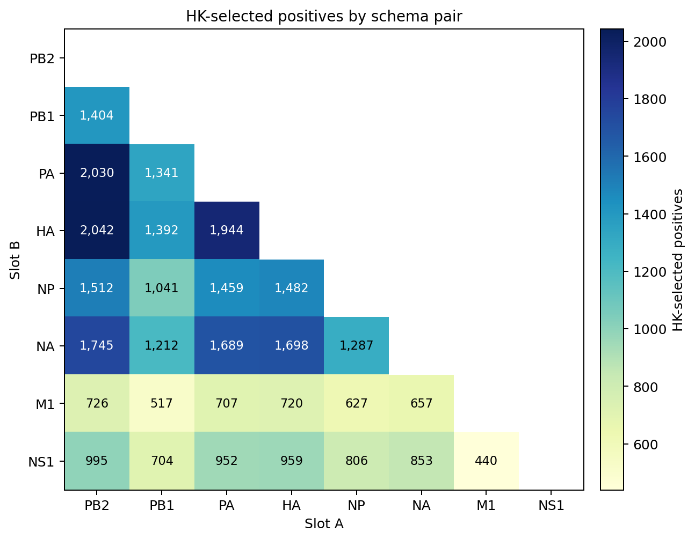
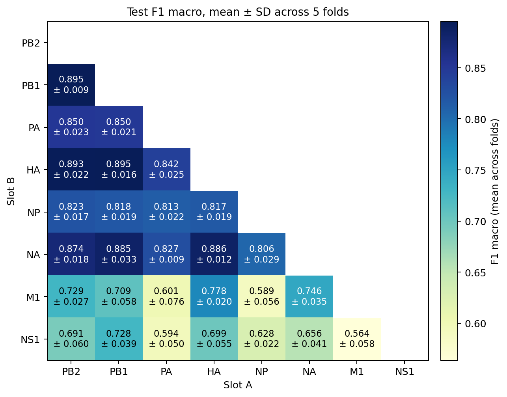
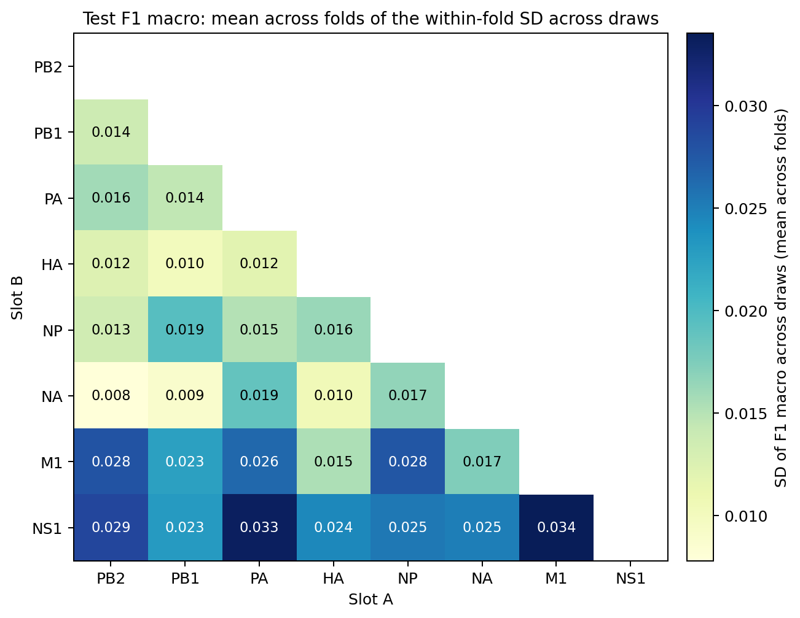

# Methods-development record: influenza segment-pair classification

**Status: Superseded on 2026-11-24.** The [current paper plan](2026-11-24_paper_plan_v2.md) presents Task 2 first and derives Task 1 from its datasets. The sections below preserve the original design, results and status at the time.

This plan is based on Jim's plan of 2026-10-08 (`plan-Jim-10-8-26-original.pdf`). That PDF is not
tracked in the repo.

The paper's sections, figures and tables are outlined in `paper_outline.md`.

Main parts:

1. Establish/Prove the methods on a small population (same host, subtype, year).
2. Expand the population. Evaluate across hosts, subtypes, and years.
3. Test on isolates from future years. E.g., train=[2015-2020], test=[2021-2025].

## Flu A data

- Curated dataset of GTO files: 108K isolates
- Each file contains: nucluotide (nt) sequences, amino-acid (aa) sequences,
  various metadata
- Positive pair: an observed same-isolate segment pair
- Negative pair: a pair not observed in any isolate in the corpus. A negative
  label does not establish biological incompatibility.

```text
        Slot A CDS                Slot B CDS
            |                         |
            v                         v
    generate features         generate features
            |                         |
            v                         v
           x_A                       x_B
            |                         |
            +------------+------------+
                         |
                         v
              concatenate: [x_A, x_B]
                         |
                         v
                LightGBM classifier
                         |
                         v
           probability of a positive pair
                         |
                         v
                     threshold
                         |
                         v
              predicted label: 1 or 0
```


# 1. Establish the methods on `Human-H3N2-2024`

**Status: IMPLEMENTED (2026-10-15).** The 28 datasets were built. All 140 `1A`
fits and all 1,400 `1B` redraw fits completed at commit `ba9b108`. The final
report is in `results/flu/July_2025/task1_28p_codon_matched_20261015_194607_report/`.

**Aligned features (2026-11-19).** Task 1 was rerun with codons placed in
protein-alignment columns. Over the 28 pairs, mean test F1 macro was 0.769
aligned and 0.767 pinned. 15 pairs scored identically, and the 13 pairs with PB1
or NS1 changed by less than one fold SD, except PB1-NS1 (0.728 to 0.647). See
`docs/results/2026-11-19_task1_aligned_codon_28p.md`.

**Goal.** Establish the methods on a narrow population that contains a single
*metadata group*. This will help to decide which feature representations and
models to carry forward into Parts 2 and 3.


## 1A. Performance for All 28 Schema Pairs

**Goal.** Describe the dataset construction process and evaluate performance
across the 28 schema pairs.

### Dataset Construction (methods).

Build one dataset for each of the 28 pairs. For a each pair, we keep
`Human-H3N2-2024` isolates with complete CDS at their pinned lengths.
Pair the two sequences from each *eligible* isolate.
Deduplicate these positives by the `nt_cds` pair key, made from the two CDS
nucleotide hashes. Thus, different CDS sequences remain distinct even if they
encode the same protein sequence. Run Hopcroft-Karp (HK) on the deduplicated
pairs to select the largest set in which each CDS sequence occurs at most once
in each slot. Each schema pair retains all of its HK-selected positives; pairs
are not downsampled to a common size. The selected counts range from 440 for
M1-NS1 to 2,042 for PB2-HA.

#### Dataset build steps

The flowchart shows the order of operations. Its counts are the record of the
pinned Human-H3N2-2024 run, `task1_28p_codon_matched_20261015_194607_pb1_ha`,
for PB1-HA, fold 0. The aligned build of the same pair is under
[Dataset build steps in aligned mode](#dataset-build-steps-in-aligned-mode).

```text
[1] Build the negative blocker from the whole corpus (co-occurrence set)
    Input:  108,530 corpus isolates
    Action: collect the same-isolate nt_cds pair key from each isolate
    Output: 82,657 distinct observed pair keys ───────────────────────┐
                                                                      │
[2] Filter the population                                             │
    Input:  108,530 corpus isolates                                   │
    Action: keep Human, H3N2, 2024                                    │
    Output: 5,346 isolates                                            │
              ↓                                                       │
[3] Require an eligible PB1-HA pair                                   │
    Input:  5,346 isolates                                            │
    Action: require both segments with complete CDS at pinned lengths │
    Output: 2,945 eligible isolates                                   │
              ↓                                                       │
[4] Deduplicate positives                                             │
    Input:  2,945 eligible isolates                                   │
    Action: keep one row per nt_cds pair key                          │
    Output: 2,327 unique positive pairs                               │
              ↓                                                       │
[5] Select positives with HK                                          │
    Input:  2,327 unique positive pairs                               │
    Action: use each CDS sequence at most once per slot               │
    Output: 1,392 selected positives                                  │
              ↓                                                       │
[6] Make 5 CV folds                                                   │
    Input:  1,392 selected positives                                  │
    Action: assign test pairs; split the remainder into train/val     │
    Output: train/val/test = 973/140/279 positives                    │
              ↓                                                       │
[7] Draw negatives                                                    │
    Input:  split positives + observed pair keys from [1] <───────────┘
    Action: one matched, one-use negative per positive
    Output: train/val/test = 973/140/279 negatives
              ↓
[8] Combine negatives and positives
    Input:  split positives from [6] and split negatives from [7]
    Action: combine and assign labels 0 to negatives and 1 to positives
    Output: train/val/test = 1,946/280/558 pairs
```

1. **Blocker.** The whole corpus contains 108,530 same-isolate PB1-HA pairs.
   Deduplicating their `nt_cds` pair keys leaves 82,657 distinct keys. Step 7
   rejects any negative candidate with one of these keys.
2. **Population.** Filters records to retain specific host, subtype and year.
   This results in 5,346 isolates/positives for PB1-HA.
3. **Eligibility.** Keep isolates that have complete CDS at its pinned length
   for both PB1 and HA (2,277 nt and 1,701 nt, respectively).
   This results in 2,945 isolates/positives for PB1-HA.
4. **Deduplication.** Collapse identical CDS pair keys across those isolates.
   This results in 2,327 distinct positives for PB1-HA (618 pairs dropped).
5. **HK selection.** Find a maximum-size set of positives with one use per CDS
   sequence in each slot. This means a sequence appears at most once in a
   positive pair per slot across the dataset.
   This results in 1,392 isolates/positives for PB1-HA.
6. **CV split.** Assign selected positives to 5 test folds. Split the remaining
   positives into train and val sets for each fold.
   This results in train/val/test = 973/140/279 positives.
7. **Negative draw.** Draw negatives inside each split, using only sequences
   from that split's positives (sampler: `matched_balanced_usage_negatives`).
   - Reject:
      - observed corpus co-occurrences (the negative blocker set)
      - negatives already drawn in the fold
   - Every sequence appears both in a positive and negative pair.
8. **Combine pairs.** Add the negatives from step 7 to the positives in each
   split. Label positives 1 and negatives 0. For PB1–HA fold 0, this gives
   1,946 training, 280 validation, and 558 test pairs.

#### Dataset build steps in aligned mode

The aligned build keeps the steps above and changes eligibility [3]. A record is
eligible only if the retention rule kept it, so the dataset holds exactly the
records the aligned codon caches hold. The counts are for
`task1_28p_aligned_codon_matched_20261119_145832_pb1_ha`, PB1-HA, fold 0.

```text
[1] Build the negative blocker from the whole corpus (co-occurrence set)
    Input:  108,530 corpus isolates
    Action: collect the same-isolate nt_cds pair key from each isolate
    Output: 82,657 distinct observed pair keys ───────────────────────┐
                                                                      │
[2] Filter the population                                             │
    Input:  108,530 corpus isolates                                   │
    Action: keep Human, H3N2, 2024                                    │
    Output: 5,346 isolates                                            │
              ↓                                                       │
[3] Require an eligible PB1-HA pair                                   │
    Input:  5,346 isolates                                            │
    Action: require both records kept by the retention rule           │
    Output: 2,958 eligible isolates                                   │
              ↓                                                       │
[4] Deduplicate positives                                             │
    Input:  2,958 eligible isolates                                   │
    Action: keep one row per nt_cds pair key                          │
    Output: 2,338 unique positive pairs                               │
              ↓                                                       │
[5] Select positives with HK                                          │
    Input:  2,338 unique positive pairs                               │
    Action: use each CDS sequence at most once per slot               │
    Output: 1,401 selected positives                                  │
              ↓                                                       │
[6] Make 5 CV folds                                                   │
    Input:  1,401 selected positives                                  │
    Action: assign test pairs; split the remainder into train/val     │
    Output: train/val/test = 980/140/281 positives                    │
              ↓                                                       │
[7] Draw negatives                                                    │
    Input:  split positives + observed pair keys from [1] <───────────┘
    Action: one matched, one-use negative per positive
    Output: train/val/test = 980/140/281 negatives
              ↓
[8] Combine negatives and positives
    Input:  split positives from [6] and split negatives from [7]
    Action: combine and assign labels 0 to negatives and 1 to positives
    Output: train/val/test = 1,960/280/562 pairs
```

Step [3] dropped these records, read from `records_kept_by_retention_rule.json`:

| | PB1 | HA |
|---|---:|---:|
| Records in the population | 5,346 | 5,346 |
| Dropped: incomplete CDS | 2,388 | 7 |
| Dropped: CDS length | 0 | 0 |
| Dropped: gap pattern | 0 | 0 |
| Kept | 2,958 | 5,339 |

The aligned build has 2,958 eligible isolates and the pinned build 2,945. The 13
extra isolates carry a complete PB1 CDS of 2,274 nt. The retention rule keeps
that length, and the 2,277-nt pin drops it. Every HA record of this population
is 1,701 nt in both builds. The two builds therefore select different positives,
1,401 and 1,392, and their folds differ.


### Dataset Construction (results).

The numbers below show the final positive count for each of the 28 schema pairs
(right before CV splitting). The table gives the counts from the dataset
construction steps: `Eligible isolates` is step 3, `Unique positives` is step 4,
and `HK selected` is step 5 (aggregated in `allpairs_summary.csv`).



**Table:**

`Unique positives` counts distinct `nt_cds` pair keys. `Unique A` and
`Unique B` count distinct CDS sequences among those pairs, before HK selection.
The `HK selected` is the set of positives for each schema pair.

| # | Pair ID | Schema pair | Eligible isolates | Unique positives | Unique A | Unique B | HK selected |
|---:|---|---|---:|---:|---:|---:|---:|
| 1 | 1-2 | PB2-PB1 | 2,945 | 2,349 | 1,788 | 1,790 | 1,404 |
| 2 | 1-3 | PB2-PA | 5,324 | 3,837 | 2,808 | 2,712 | 2,030 |
| 3 | 1-4 | PB2-HA | 5,329 | 3,796 | 2,810 | 2,681 | 2,042 |
| 4 | 1-5 | PB2-NP | 5,318 | 3,484 | 2,800 | 1,830 | 1,512 |
| 5 | 1-6 | PB2-NA | 5,167 | 3,532 | 2,745 | 2,203 | 1,745 |
| 6 | 1-7 | PB2-M1 | 5,332 | 3,128 | 2,813 | 812 | 726 |
| 7 | 1-8 | PB2-NS1 | 5,313 | 3,204 | 2,800 | 1,120 | 995 |
| 8 | 2-3 | PB1-PA | 2,939 | 2,332 | 1,786 | 1,710 | 1,341 |
| 9 | 2-4 | PB1-HA | 2,945 | 2,327 | 1,790 | 1,756 | 1,392 |
| 10 | 2-5 | PB1-NP | 2,942 | 2,162 | 1,787 | 1,227 | 1,041 |
| 11 | 2-6 | PB1-NA | 2,939 | 2,237 | 1,786 | 1,480 | 1,212 |
| 12 | 2-7 | PB1-M1 | 2,945 | 1,992 | 1,790 | 582 | 517 |
| 13 | 2-8 | PB1-NS1 | 2,937 | 2,029 | 1,788 | 781 | 704 |
| 14 | 3-4 | PA-HA | 5,329 | 3,805 | 2,711 | 2,682 | 1,944 |
| 15 | 3-5 | PA-NP | 5,318 | 3,455 | 2,703 | 1,832 | 1,459 |
| 16 | 3-6 | PA-NA | 5,167 | 3,520 | 2,649 | 2,202 | 1,689 |
| 17 | 3-7 | PA-M1 | 5,335 | 3,082 | 2,716 | 812 | 707 |
| 18 | 3-8 | PA-NS1 | 5,315 | 3,214 | 2,705 | 1,121 | 952 |
| 19 | 4-5 | HA-NP | 5,323 | 3,382 | 2,673 | 1,830 | 1,482 |
| 20 | 4-6 | HA-NA | 5,173 | 3,466 | 2,634 | 2,203 | 1,698 |
| 21 | 4-7 | HA-M1 | 5,338 | 3,018 | 2,686 | 811 | 720 |
| 22 | 4-8 | HA-NS1 | 5,318 | 3,151 | 2,676 | 1,119 | 959 |
| 23 | 5-6 | NP-NA | 5,162 | 3,091 | 1,794 | 2,197 | 1,287 |
| 24 | 5-7 | NP-M1 | 5,326 | 2,356 | 1,833 | 808 | 627 |
| 25 | 5-8 | NP-NS1 | 5,307 | 2,540 | 1,824 | 1,114 | 806 |
| 26 | 6-7 | NA-M1 | 5,176 | 2,620 | 2,206 | 800 | 657 |
| 27 | 6-8 | NA-NS1 | 5,156 | 2,794 | 2,196 | 1,092 | 853 |
| 28 | 7-8 | M1-NS1 | 5,323 | 1,840 | 806 | 1,122 | 440 |

- All pairs have around 5K eligible isolates, except the 7 pairs that contain
  PB1, which have around 3K
- Only 55% of the isolates carry a complete PB1 CDS (at 2,277-nt length); step 3
- Almost all of the incomplete PB1 CDS are 2,274-nt. This is one codon short of
  the 2,277-nt length. Is the terminal stop just missing?

Sources:
- `docs/results/2026-09-07_cds_length_survey.md`
- `docs/results/2026-09-08_cds_pair_capacity.md`

**HK selection.** For each schema pair, we deduplicate the positives and then
keep the largest subset in which no CDS sequence appears twice in the same slot.
To do this we build a bigraph (bipartite graph). One side has the unique slot-A
sequences, the other side has the unique slot-B sequences, and each positive is
an edge between its two sequences (PB1-HA: 1,790 slot-A nodes, 1,756 slot-B
nodes, 2,327 edges).
A set of edges with no shared node is a matching, and it corresponds exactly to
a set of positives with no sequence reused in either slot. The Hopcroft-Karp (HK)
algorithm finds a maximum matching, meaning one with as many edges as possible.
For PB1-HA it keeps 1,392 positives. More than one maximum matching can exist,
but they all have the same size, so the number kept depends only on the data and
not on row order. We use networkx's `matching.hopcroft_karp_matching`.
Sequences and edges are sorted before the call, so the same matching is returned
on every run.


### Model Development and Evaluation.

#### Feature Representation

##### Codon-encoding CDS (`nt_cds`):

- Split each complete CDS into codons and encode one integer ID per codon site.
  Concatenate the slot A and B vectors.
- The IDs come from `genslm_vocab/tokenizer_config.json`.
- LightGBM treats each codon site as categorical nominal (with `categorical_feature`).
- The width of the concatenated vectors is the sum of their codon counts.
- Why codon-encoding:
  - GenSLM
  - feature importance `docs/plans/2026-09-14_codon_site_features_plan.md`
  - Nucleotide site-encoding outperformed k-mers on a subset of schema pairs that we explored `docs/results/2026-09-08_h3n2_2024_progress_report.md`

#### Training and Evaluation

- 28 pairs x 5 folds --> 140 model trainings
- LightGBM classifier (classification threshold of 0.5)
- F1 macro, Precision, Recall, AUC-ROC, AUC-PR, Brier


#### Results




**Table:**
- The pairs are ranked by F1 macro averaged across the 5 folds
- The dataset size per schema pair is 2 x `Positives`; `Positives` is the
`HK selected` column from the previous table (i.e., after filtering and dedup)

| Rank | Pair ID | Schema pair | Positives | Features | F1 macro | Precision | Recall | AUC-ROC | AUC-PR | Brier |
|---:|---|---|---:|---:|---:|---:|---:|---:|---:|---:|
| 1 | 1-2 | PB2-PB1 | 1,404 | 1,519 | 0.895 ± 0.009 | 0.859 ± 0.012 | 0.947 ± 0.015 | 0.944 ± 0.007 | 0.923 ± 0.018 | 0.121 ± 0.034 |
| 2 | 2-4 | PB1-HA | 1,392 | 1,326 | 0.895 ± 0.016 | 0.858 ± 0.010 | 0.948 ± 0.038 | 0.948 ± 0.007 | 0.928 ± 0.009 | 0.104 ± 0.029 |
| 3 | 1-4 | PB2-HA | 2,042 | 1,327 | 0.893 ± 0.022 | 0.847 ± 0.028 | 0.963 ± 0.012 | 0.941 ± 0.014 | 0.918 ± 0.020 | 0.099 ± 0.029 |
| 4 | 4-6 | HA-NA | 1,698 | 1,037 | 0.886 ± 0.012 | 0.843 ± 0.011 | 0.950 ± 0.013 | 0.940 ± 0.012 | 0.918 ± 0.019 | 0.099 ± 0.015 |
| 5 | 2-6 | PB1-NA | 1,212 | 1,229 | 0.885 ± 0.033 | 0.849 ± 0.037 | 0.938 ± 0.027 | 0.929 ± 0.023 | 0.900 ± 0.018 | 0.125 ± 0.039 |
| 6 | 1-6 | PB2-NA | 1,745 | 1,230 | 0.874 ± 0.018 | 0.831 ± 0.023 | 0.942 ± 0.017 | 0.933 ± 0.012 | 0.913 ± 0.020 | 0.108 ± 0.015 |
| 7 | 1-3 | PB2-PA | 2,030 | 1,477 | 0.850 ± 0.023 | 0.810 ± 0.033 | 0.919 ± 0.008 | 0.929 ± 0.013 | 0.914 ± 0.018 | 0.118 ± 0.013 |
| 8 | 2-3 | PB1-PA | 1,341 | 1,476 | 0.850 ± 0.021 | 0.800 ± 0.020 | 0.936 ± 0.026 | 0.918 ± 0.017 | 0.896 ± 0.025 | 0.121 ± 0.015 |
| 9 | 3-4 | PA-HA | 1,944 | 1,284 | 0.842 ± 0.025 | 0.798 ± 0.030 | 0.919 ± 0.016 | 0.917 ± 0.016 | 0.892 ± 0.014 | 0.122 ± 0.014 |
| 10 | 3-6 | PA-NA | 1,689 | 1,187 | 0.827 ± 0.009 | 0.782 ± 0.010 | 0.911 ± 0.011 | 0.905 ± 0.004 | 0.877 ± 0.013 | 0.134 ± 0.010 |
| 11 | 1-5 | PB2-NP | 1,512 | 1,259 | 0.823 ± 0.017 | 0.759 ± 0.018 | 0.954 ± 0.003 | 0.901 ± 0.015 | 0.880 ± 0.017 | 0.138 ± 0.020 |
| 12 | 2-5 | PB1-NP | 1,041 | 1,258 | 0.818 ± 0.019 | 0.769 ± 0.018 | 0.916 ± 0.024 | 0.900 ± 0.016 | 0.886 ± 0.024 | 0.159 ± 0.026 |
| 13 | 4-5 | HA-NP | 1,482 | 1,066 | 0.817 ± 0.019 | 0.765 ± 0.021 | 0.923 ± 0.016 | 0.898 ± 0.011 | 0.875 ± 0.020 | 0.143 ± 0.018 |
| 14 | 3-5 | PA-NP | 1,459 | 1,216 | 0.813 ± 0.022 | 0.765 ± 0.021 | 0.907 ± 0.019 | 0.902 ± 0.016 | 0.889 ± 0.016 | 0.136 ± 0.010 |
| 15 | 5-6 | NP-NA | 1,287 | 969 | 0.806 ± 0.029 | 0.751 ± 0.031 | 0.927 ± 0.011 | 0.888 ± 0.021 | 0.864 ± 0.023 | 0.144 ± 0.020 |
| 16 | 4-7 | HA-M1 | 720 | 820 | 0.778 ± 0.020 | 0.727 ± 0.023 | 0.904 ± 0.029 | 0.855 ± 0.020 | 0.833 ± 0.024 | 0.188 ± 0.020 |
| 17 | 6-7 | NA-M1 | 657 | 723 | 0.746 ± 0.035 | 0.698 ± 0.041 | 0.901 ± 0.042 | 0.842 ± 0.030 | 0.809 ± 0.030 | 0.184 ± 0.013 |
| 18 | 1-7 | PB2-M1 | 726 | 1,013 | 0.729 ± 0.027 | 0.680 ± 0.024 | 0.894 ± 0.028 | 0.812 ± 0.013 | 0.790 ± 0.016 | 0.198 ± 0.020 |
| 19 | 2-8 | PB1-NS1 | 704 | 990 | 0.728 ± 0.039 | 0.687 ± 0.039 | 0.859 ± 0.027 | 0.823 ± 0.032 | 0.815 ± 0.030 | 0.193 ± 0.011 |
| 20 | 2-7 | PB1-M1 | 517 | 1,012 | 0.709 ± 0.058 | 0.666 ± 0.047 | 0.897 ± 0.045 | 0.799 ± 0.055 | 0.770 ± 0.055 | 0.214 ± 0.021 |
| 21 | 4-8 | HA-NS1 | 959 | 798 | 0.699 ± 0.055 | 0.657 ± 0.043 | 0.891 ± 0.014 | 0.789 ± 0.044 | 0.776 ± 0.040 | 0.197 ± 0.012 |
| 22 | 1-8 | PB2-NS1 | 995 | 991 | 0.691 ± 0.060 | 0.657 ± 0.053 | 0.851 ± 0.054 | 0.789 ± 0.052 | 0.781 ± 0.055 | 0.198 ± 0.019 |
| 23 | 6-8 | NA-NS1 | 853 | 701 | 0.656 ± 0.041 | 0.626 ± 0.033 | 0.826 ± 0.032 | 0.760 ± 0.042 | 0.749 ± 0.043 | 0.216 ± 0.012 |
| 24 | 5-8 | NP-NS1 | 806 | 730 | 0.628 ± 0.022 | 0.602 ± 0.015 | 0.846 ± 0.031 | 0.719 ± 0.037 | 0.714 ± 0.040 | 0.221 ± 0.009 |
| 25 | 3-7 | PA-M1 | 707 | 970 | 0.601 ± 0.076 | 0.591 ± 0.044 | 0.894 ± 0.046 | 0.710 ± 0.058 | 0.698 ± 0.056 | 0.222 ± 0.018 |
| 26 | 3-8 | PA-NS1 | 952 | 948 | 0.594 ± 0.050 | 0.581 ± 0.030 | 0.868 ± 0.025 | 0.701 ± 0.051 | 0.694 ± 0.051 | 0.224 ± 0.012 |
| 27 | 5-7 | NP-M1 | 627 | 752 | 0.589 ± 0.056 | 0.581 ± 0.040 | 0.850 ± 0.070 | 0.694 ± 0.046 | 0.681 ± 0.044 | 0.229 ± 0.009 |
| 28 | 7-8 | M1-NS1 | 440 | 484 | 0.564 ± 0.058 | 0.564 ± 0.034 | 0.848 ± 0.055 | 0.683 ± 0.064 | 0.684 ± 0.062 | 0.231 ± 0.007 |

**Results Summary**:

- Mean F1 macro on test set ranges: **0.564** for M1–NS1 (row 28) to **0.895**
  for PB2–PB1 (row 1)
- The SD across folds ranges: **0.009** for PB2–PB1 (row 1) to **0.076** for
  PA–M1 (row 25) (0.9 to 7.6 percentage points).
- At the fixed 0.5 threshold, Recall exceeds Precision for all 28 pairs.
- All 13 pairs containing M1 or NS1 ranked below the other 15 pairs by F1 macro.
  Subtype and collection date prediction tasks also show weaker results for
  segments 7 and 8.
- AUC-ROC and AUC-PR rank the pairs similarly (Spearman 0.99).
- Brier measures the error in the predicted probabilities. It depends on the
  probabilities themselves, not on the classification threshold (F1, precision,
  recall) or on the ranking (AUC-ROC, AUC-PR). A model that predicts 0.5 for
  every pair scores 0.25 on a balanced test set.
- Mean Brier and F1 macro are strongly inversely correlated (Spearman -0.97).
  M1-NS1 scores 0.231 (close to that 0.25 reference) and its test predictions
  cluster near 0.5. Brier alone cannot distinguish weak discrimination from
  miscalibration.
- A high Brier does not by itself mean weak classification. A model that
  predicted 0.51 for every positive and 0.49 for every negative would score 1.0
  on the other five metrics at the 0.5 threshold, and 0.24 on Brier.

**`TODO`**:

* Other features:
  * Site-level nucleotide encoding of CDS.
  * Nucleotide k-mer counts from CDS.
* [Post-hoc, required] Investigate why recall exceeds precision for all 28
  pairs at the fixed 0.5 threshold. For each pair, compare FP and FN counts and
  the fraction predicted positive across the 5 test folds. Plot test
  probabilities by true label for representative high-, middle-, and low-F1
  pairs to see where the threshold falls.
* [Post-hoc, optional] Feature importance.
* [Post-hoc, optional] Correlation of prediction performance (e.g., F1
  macro) with sample size (`HK selected`) and with sequence length (`Features`,
  the sum of the two proteins' codon counts). Both columns are already in
  `allpairs_summary.csv`. For the precedent, see Experiment 2 of
  `docs/plans/2026-09-14_codon_site_features_plan.md`, after its table.
* [1A Methods] Deferred for the paper: naive baselines, HPO, and whether
  the best HP settings shift across schema pairs.


## 1B. Sensitivity to the Sampling of Training Negatives

**Goal.** The training positives of a split are determined by the data, but the
training negatives are sampled from a much larger set of possible negative
pairs. Measure how much test set prediction performance varies when models are
trained on different sets of negatives and evaluated on the same test pairs.

**Methods.**
- We start with the 5-fold datasets generated in `1A`.
- For every fold, redraw the training negatives `r`=10 times, each time with a
  different random seed, and train one model per draw. What remains fixed:
  training positives, val and test sets, LightGBM seed. This results in `r`
  models per fold.
- Across 28 pairs and 5-folds, `r = 10` draws per fold produce 1,400 sampled
  training negative sets and 1,400 trained models (28 pairs × 5 folds × 10
  draws).
- Each of the `r` models predicts the same test pairs. This results in `r`=10
  predictions for each test pair.

**Results.** The table shows **fold 0** for each pair, sorted by mean F1 macro.

`F1 macro`:
Each F1 value is the mean ± SD of the 10 test scores, one from each negative
draw (other folds are in `redraw_by_pair_fold.csv`).


`Median $s_i$ (true pos)` and `Median $s_i$ (true neg)`:
- $i$ is one test pair, and $m$ is one model. There are 10 models, one per negative draw, so $m = 1, …, 10$. 
- $p_{im}$ is the predicted probability by model $m$.
<!-- - $\bar p_i$ is the mean of 10 probabilities. -->
- $s_i$ is the sample SD of the 10 probabilities.

<!-- For test pair $i$, let $p_{im}$ be its predicted probability from model $m$.
Its sample SD across the $r = 10$ models is

$$
\bar p_i = \frac{1}{r}\sum_{m=1}^{r}p_{im}, \qquad
s_i = \sqrt{\frac{1}{r-1}\sum_{m=1}^{r}(p_{im}-\bar p_i)^2}.
$$ -->

<!-- The two probability SD columns report $\operatorname{median}_{i:y_i=1}(s_i)$
and $\operatorname{median}_{i:y_i=0}(s_i)$, where $y_i$ is the true label. -->

How to read the table:

- Fold 0 has 10 models, one per negative draw with different seeds. All 10 are
  scored on the same test pairs. E.g., PB1-HA fold 0 has 558 test pairs (279
  pos and 279 neg), and 1946 train pairs (973 pos and 973 neg per draw).
- Column `F1 macro`. How much does test performance change when the training
  negatives change?
  E.g., 0.909 ± 0.007 is the F1 mean ± SD over the 10 models.
  The ± is the spread across negative draws (not across folds as in `1A`).
- Columns `Median $s_i$ (true pos)` and `Median $s_i$ (true neg)`. How
  much does predicted probability deviate across the 10 models?

| # | Pair ID | Schema pair | F1 macro | Median $s_i$ (true pos) | Median $s_i$ (true neg) |
|---:|---|---|---:|---:|---:|
| 1 | 2-4 | PB1-HA | 0.909 ± 0.007 | 0.051 | 0.057 |
| 2 | 1-4 | PB2-HA | 0.894 ± 0.010 | 0.059 | 0.061 |
| 3 | 2-6 | PB1-NA | 0.894 ± 0.009 | 0.061 | 0.068 |
| 4 | 1-2 | PB2-PB1 | 0.885 ± 0.015 | 0.071 | 0.079 |
| 5 | 4-6 | HA-NA | 0.868 ± 0.020 | 0.072 | 0.086 |
| 6 | 1-3 | PB2-PA | 0.863 ± 0.007 | 0.045 | 0.048 |
| 7 | 1-6 | PB2-NA | 0.858 ± 0.007 | 0.058 | 0.070 |
| 8 | 3-4 | PA-HA | 0.857 ± 0.024 | 0.064 | 0.080 |
| 9 | 2-3 | PB1-PA | 0.836 ± 0.020 | 0.053 | 0.056 |
| 10 | 3-6 | PA-NA | 0.831 ± 0.009 | 0.046 | 0.048 |
| 11 | 4-5 | HA-NP | 0.824 ± 0.008 | 0.057 | 0.055 |
| 12 | 5-6 | NP-NA | 0.815 ± 0.006 | 0.039 | 0.047 |
| 13 | 2-5 | PB1-NP | 0.814 ± 0.020 | 0.045 | 0.054 |
| 14 | 1-5 | PB2-NP | 0.813 ± 0.014 | 0.066 | 0.090 |
| 15 | 4-7 | HA-M1 | 0.795 ± 0.009 | 0.026 | 0.035 |
| 16 | 3-5 | PA-NP | 0.770 ± 0.023 | 0.055 | 0.077 |
| 17 | 4-8 | HA-NS1 | 0.759 ± 0.018 | 0.040 | 0.050 |
| 18 | 1-7 | PB2-M1 | 0.737 ± 0.031 | 0.036 | 0.049 |
| 19 | 1-8 | PB2-NS1 | 0.732 ± 0.023 | 0.030 | 0.042 |
| 20 | 6-7 | NA-M1 | 0.703 ± 0.018 | 0.030 | 0.033 |
| 21 | 2-8 | PB1-NS1 | 0.696 ± 0.016 | 0.026 | 0.030 |
| 22 | 2-7 | PB1-M1 | 0.678 ± 0.023 | 0.028 | 0.028 |
| 23 | 6-8 | NA-NS1 | 0.662 ± 0.032 | 0.030 | 0.033 |
| 24 | 7-8 | M1-NS1 | 0.651 ± 0.041 | 0.011 | 0.016 |
| 25 | 5-8 | NP-NS1 | 0.630 ± 0.030 | 0.021 | 0.025 |
| 26 | 3-8 | PA-NS1 | 0.597 ± 0.031 | 0.019 | 0.022 |
| 27 | 5-7 | NP-M1 | 0.567 ± 0.031 | 0.012 | 0.013 |
| 28 | 3-7 | PA-M1 | 0.507 ± 0.015 | 0.014 | 0.014 |

<!-- **Matrix**. For each fold, compute the SD of test F1 macro across the 10
negative draws. Each matrix cell is the mean of those 5 SDs. This shows how
much F1 changes when we sample different training negatives for the same fold.
In 1A, the SD is across folds, where the training and test pairs also change.

 -->


## Open questions

- Should the redraw seeds start at 0, so that they match the fold ids, instead
  of running 42-51?
- Feature scope. We plan to use per-site codon features in this paper. Our
  question is whether a model can predict same-isolate segment pairs across the
  planned settings. Comparing multiple feature types could distract from that
  question.
- The 2,274-nt PB1 records end exactly where their contig ends, with no contig
  bases after the CDS in all but one case, so the bases that would complete the
  CDS were never assembled. Ask whoever produced the GTO annotations whether
  such a record should count as the same PB1 form as a 2,277-nt one, which
  would recover around 2,400 isolates.


## Implementation record

Experiments 1, 2 and 6 in `docs/plans/2026-09-14_codon_site_features_plan.md` supplied the
initial 28-pair screen and training-negative redraws. Task 1 added 5-fold experiment specs,
manifest-based dataset and fit selection, strict config and input checks, a 28-pair audit and
report, and a redraw coordinator. The final matched-negative spec is
`conf/experiments/human_h3n2_2024_28p_codon_matched_cv5.yaml`.

`scripts/run_allpairs_datasets.py` built the 28 datasets;
`src/analysis/audit_pair_datasets.py` audited them;
`scripts/run_allpairs_baselines.py` ran `1A`;
`scripts/run_allpairs_balanced_redraws.py` ran `1B`; and
`src/analysis/aggregate_allpairs_results.py --final` produced the report. The dataset, training
and redraw manifests record the selected runs, settings, code commit and input checksums. The
reported datasets and all fits used commit `ba9b108`.

- dataset prefix `task1_28p_codon_matched_20261015_194607_`
- `1A` training run `task1_28p_codon_matched_20261015_194607_lgbm_20261015_195321`
- `1B` redraw dataset prefix `task1_28p_codon_matched_20261015_194607_negredraw_20261015_200417_`
- `1B` redraw training run `task1_28p_codon_matched_20261015_194607_negredraw_20261015_200417_lgbm`
- report for `1A` and `1B`: `results/flu/July_2025/task1_28p_codon_matched_20261015_194607_report/`

Each redraw drew its negatives with `matched_balanced_usage_negatives`, the sampler the source
datasets were built with.


# 2. Expand the population. Evaluate across hosts, subtypes, and years.

**Status: IN PROGRESS.** The population, the 28 aligned child bundles, the
experiment spec, the capacity table and the metadata group minimum are set. The
28 datasets have not been built and no model has been fit.

**Goal.** Train on a *population* containing several hosts, subtypes or years,
and measure the overall performance as well as within each *metadata group*.

**Definitions**:
* *Population*: a dataset containing all the isolates selected by the dataset
  filters.
* *Metadata group*: a dataset subset with one exact `(host, subtype, year)`
  combination, where `host` is a host group such as `Duck` rather than an animal
  such as `Mallard`.

Task 1 dataset filters are `Human, H3N2, 2024`, so its population held
one metadata group. The Task 2 population holds several metadata groups, and
its reports distinguish the two terms. The negative sampler matches on the
metadata group, so it matches on the host group too.

### Dataset Construction (methods).

### The population

* Filters: `[Human, Swine, Chicken, Duck]`, `[H3N2, H1N1, H5N1]`, `2010-2025`.
* Size: 61,635 isolates of the July 2025 corpus. This is counted from the
  metadata alone, so it's the upper bound for schema pair.
* `filter_by_metadata` keeps only values in the 3 filter lists. An isolate
  missing host, HN subtype or year is dropped.
* `host` is a host group, not an animal, so `Duck` covers 54 animal names and
  `Chicken` covers 3. The map is `conf/virus/flu_host_groups.yaml`.
* Chicken and Duck stay separate.
    * Jamie's paper uses human, swine, duck, chicken and other.
    * Marcus's paper uses 8 coarser buckets: human, avian, nonhuman mammal,
      environment, unknown, lab, sea mammal and other.
    * Open question 3 below asks whether to merge Chicken and Duck into one
      `Avian` group, as Marcus does.
* Of the 192 possible `(host, HN subtype, year)` groups, 149 have at least one
  isolate and 68 have at least 100. The largest is Human-H3N2-2024 with 5,403
  isolates, the smallest Chicken-H1N1-2016 with 1. Groups too small to give
  every split two positives are dropped before the folds are made; see the
  metadata group minimum under Build settings.
* The capacity run on the records the retention rule keeps supports all 28
  schema pairs, with 9,296 (M1-NS1) to 28,879 (PB2-PA) `HK selected` positives.
  The table is
  `results/flu/July_2025/pair_capacity_8_proteins_4host_3subtype_2010_2025_aligned/pair_capacity.csv`.

Host and subtype are not crossed:

| Isolates | H1N1 | H3N2 | H5N1 |
|---|---:|---:|---:|
| Human | 20,325 | 29,682 | 45 |
| Swine | 3,724 | 3,194 | 16 |
| Duck | 269 | 221 | 2,158 |
| Chicken | 2 | 18 | 1,981 |

* 6 of the 12 cells hold 61,064 of the 61,635 isolates. Human and Swine are
  H1N1 and H3N2; Chicken and Duck are H5N1.
* Chicken-H1N1 has 2 isolates and Chicken-H3N2 has 18, so no model can be
  scored there.
* So host and subtype cannot be treated as two crossed factors, and a host
  effect measured here is partly a subtype effect. A comparison across hosts
  has to say which subtype it holds fixed. Only H5N1 is shared by all 4 host
  groups.

### Build settings

The order of operations is the one in [Dataset build steps](#dataset-build-steps).
Task 2 changes the population and the negative sampler, not the steps.

* The 28 child bundles are `flu_28p_4host_aligned_codon_*`. The experiment spec
  `conf/experiments/4host_3subtype_2010_2025_28p_codon_aligned_matched_cv5.yaml`
  sets `dataset.n_folds=5` for both dataset building and training; the bundles
  retain their inherited 4-fold setting.
* Positives are selected by HK after global pair-key deduplication.
* Each split receives one matched balanced-usage negative per positive. Its two
  sequences come from different selected positives in the same split and
  metadata group.
* The sampler matches exact years with `year_match: exact`, rather than the
  default year bins.
* The metadata group minimum, `dataset.min_metadata_group_positives: 20`, drops
  every metadata group with fewer than 20 `HK selected` positives before the
  folds are made. The test folds and the validation split are then stratified
  by group, so every kept group has positives in all three splits of every
  fold, and no group is scored without training positives. The matched sampler
  stops the build if a split holds a group with fewer than 2 positives. With 5
  folds, a group of 20 puts 4 positives in each test fold and about 2 of the
  other 16 in validation. `metadata_groups_dropped.json` records each dropped
  group and its positives.
* Counted from each pair's `HK selected` positives before any build, the
  minimum keeps 73 to 83 of each pair's 118 to 147 groups. It drops 1.1% to
  3.9% of each pair's positives, and 11,016 of 555,921 over the 28 pairs. The
  same 8 host and subtype combinations keep groups in every pair.
  Chicken-H1N1, Chicken-H3N2, Human-H5N1 and Swine-H5N1 keep none in any pair.
  So H5N1 is scored only in Chicken and Duck, and no subtype is scored in all 4
  host groups.
* A trial build of PB1-HA gave that pair's counted values: 79 of 139 groups
  kept and 447 of 27,060 positives dropped. It drew matched negatives in all 79
  groups of every split of all 5 folds.
* The dataset audit checks every saved negative using both endpoints' isolate
  metadata, not the `neg_regime` field (`check_matched_negatives` in
  `src/analysis/audit_pair_datasets.py`).
* Training is the one Task 1 describes under Model Development and Evaluation.
  The features are per-site codons as in Task 1, but placed in protein-alignment
  columns rather than at a pinned CDS length (see the prerequisite below).

### Prerequisite: aligned codon features

Per-site codon features need every record to have the same sites, so Task 2
aligns all 8 proteins instead of pinning CDS lengths. Pinned lengths do not fit
this population. HA's pin of 1,701 nt keeps 13 of 3,754 complete H5N1 records,
because the main H5 form is 1,704 nt. NA's pin of 1,410 nt holds both N1 and N2,
whose residues do not fill the same alignment columns. Task 1 scored the same on
aligned and pinned features, but it holds one subtype, so Task 2 is the test of
whether alignment helps. The alignments and the retention rule are in
`docs/results/2026-11-09_protein_alignment.md`, the aligned features in
`docs/plans/2026-11-17_aligned_codon_features_plan.md`, and the Task 1 run on
them in `docs/results/2026-11-19_task1_aligned_codon_28p.md`.

### Matched balanced-usage negatives

An ordinary balanced negative can join isolates from different groups. The matched sampler in
`src/datasets/_negative_sampling.py` instead assigns each selected positive to its retained source
isolate's group, then pairs slot-A and slot-B sequences from different positives within that group
and split. Global pair-key deduplication remains in place. If a sequence pair was observed in
several groups before deduplication, only its retained isolate's group receives it; the retained
isolate depends on input row order.

The Task 2 master inherits the matched profile from the Task 1 master bundles: all eight regime
targets, with `host_subtype_year: 1.0` and the others zero, plus `year_match: exact` and
`on_shortfall: error`. The config guard accepts this profile with `negative_scope: balanced`, three
matching axes and a 1:1 negative ratio. It rejects other `negative_sampling` profiles with balanced
scope.

For each group and split, the sampler finds a one-to-one assignment from selected slot-A sequences
to selected slot-B sequences. It excludes observed positive pairs and negatives already drawn in
the fold. An augmenting-path search proves whether the assignment exists. A group with one
positive, no valid assignment, repeated selected sequences in a slot or more than 5,000 positives
raises an error naming the group and split. `duplicate_stats.json` records the group sizes and
successful negative counts. Each endpoint retains its own source isolate's metadata. Saved
negatives carry `neg_regime: host_subtype_year` and `metadata_match_count: 3`.

### Reports

`allpairs_summary.csv` gives one row per schema pair for the whole population.
`src/analysis/metadata_group_report.py` writes `metadata_group_counts.csv` from saved train,
validation and test pairs, with positive and negative counts by schema pair, fold, split and group.
The counts sum to each split's totals. It writes `test_metrics_by_metadata.csv` from each fold's
`test_predicted.csv`, using that model's decision threshold. Each row contains the group values,
class counts, confusion counts, F1 macro, AUC-ROC, precision and recall. If a run has a one-class
group, its metrics are NaN for that fold. The figure code excludes those folds from its mean and shows how
many folds contributed.

The report contains four figures: `matrix_f1_macro.png` for the whole population,
`metrics_by_group_f1_macro.png` for the joint groups, `metrics_by_axis_f1_macro.png` for the
pooled host, subtype and year values, and `counts_by_group.png` for test positives summed over
folds. The metric figures show each cell's fold mean above its fold SD and share a color scale.
`--metric` can draw other supported metrics. `--min_test_pairs` can mask thin group cells; its
default of 0 masks none. Figure titles and CSV rows identify the population. Task 2 keeps 73 to 83
joint groups per pair. Whether the per-group figure stays readable at that size has not been
checked.

### Results

Not run yet. Building the 28 datasets is the next step.

When it runs, this section reports:

* One row per schema pair for the whole population, from `allpairs_summary.csv`.
* F1 macro, AUC-ROC, precision and recall per metadata group, per schema pair
  and per fold, from `test_metrics_by_metadata.csv`.
* Positive and negative counts per metadata group, split and fold, from
  `metadata_group_counts.csv`.
* The 4 figures listed under Reports.
* The metadata groups each pair dropped and their positives, from
  `metadata_groups_dropped.json`.

## Open questions

Questions 1 and 2 are settled for Task 2 by the metadata group minimum under Build settings.

1. **Groups with no training positives.** If folds are assigned by positive alone, a group can
   have test positives but no training positives in a fold, and its score then measures an unseen
   group. The matched sampler does not catch this, because a split with no positives of a group
   needs no negatives there. The options were to stratify the folds by group, to mask groups below
   a minimum size (the report's `--min_test_pairs`), or to score every group and flag the unseen
   ones.

   Addressed: Task 2 stratifies the test folds and the validation split by metadata group, after
   applying the metadata group minimum. Every kept group then has positives in all three splits of
   every fold.
2. **A rule for removing small groups.** A rule that removes groups must be set before the folds
   are made. It must remove whole groups, never positives from one split, because each positive
   has one test fold. It must record what each group lost. It is not an eligibility rule, which
   decides per isolate and per schema pair.

   Addressed: the metadata group minimum drops each group with fewer than 20 `HK selected`
   positives before the folds are made, and `metadata_groups_dropped.json` lists each dropped
   group and its positives for each schema pair. If a kept group still has fewer than 2 positives
   in a split, the matched sampler stops the build.
3. **Merge Chicken and Duck into `Avian`?** Task 2 keeps them separate. Merging
   would give one bird group of 21,490 isolates corpus-wide to compare against
   Human, which is the case for it. The case against is that farmed chickens and
   mostly wild ducks are different exposures. Not for this run.


# 3. Test on future-year pairs

**Goal.** Train on past-year pairs and test on future-year pairs whose endpoint sequences were not
selected for training or validation. Report performance separately for each test year.

**Example run.** For one schema pair, use 2011–2013 as the past pool and 2014–2015 as the future
pool. Set `dataset.metadata_holdout.train: {year_range: [2011, 2013]}` and
`dataset.metadata_holdout.test: {year_range: [2014, 2015]}`. These are example years; choose a
population with enough selected positives in each split before fixing the experiment bundle. Use
the same sequence filters and `pair_key_alphabet` in both pools. The Task 1/2 codon setting uses
`nt_cds`.

1. Build positive candidates from the past pool only. Deduplicate by `pair_key`, then run
   Hopcroft–Karp (HK) once on those candidates. Randomly assign `dataset.val_ratio` of the selected
   positives to validation with a recorded seed; the rest go to training. Freeze both sets.
2. Build positive candidates from both future years. Drop a candidate if its slot-A sequence was
   selected in past training or validation, or if its slot-B sequence was selected there. Compare
   hashes in the configured `pair_key_alphabet`. Deduplicate the remaining future candidates by
   `pair_key`, then run HK once across both future years. These selected pairs form the test set;
   future selection cannot change the frozen past positives.
3. Assert that no selected `pair_key`, slot-A hash or slot-B hash occurs in more than one split.
   Record candidate, deduplicated, excluded-for-past-overlap and HK-selected counts by period.
   Also report HK-selected counts by test year. Use the source year of each retained positive for
   its test-year group.
4. Draw 1:1 balanced-usage negatives separately in each split. Use Task 2's matched profile so
   both endpoints of each negative share host, HN subtype and exact year. Fail with the split and
   group named if a one-use matching cannot be made. Train one model on the past training set,
   select its settings on past validation, and evaluate it once on the combined future test set.

**Required code changes.**
- Add a single-split temporal HK path and allow active `positive_pair_selection` with
  `metadata_holdout` and `dataset.n_folds: 1`. The current validator requires at least two folds
  for active selection. The current holdout path divides past isolates into train and validation
  before positive selection, so it must instead divide the past HK-selected pairs afterward.
- Build and select past positives before examining future candidates. Do not globally deduplicate
  positive pairs across both periods or rerun HK on their union. Reuse the positive selector and
  the existing prepartitioned-positive input to `split_dataset_v2` for negative sampling and
  audits. Save the period-specific selection counts and cross-split overlap checks.
- Negatives are already blocked in every split against a corpus-wide co-occurrence set, so this
  needs no Task 3 work. `_pair_helpers.build_corpus_cooccurrence_set` builds it on the two
  proteins of the schema pair and the configured `pair_key_alphabet`, reading the alphabet's own
  `*_final` table, so neither the population filters nor the pinned-length filter narrow it. A
  sequence pair observed together anywhere in the corpus never receives a negative label, in the
  test split as well as in training. The set spans both periods, so a co-occurrence first seen in
  a future isolate can reject a past training negative. That is accepted here: it only removes
  candidate negatives and corrects labels, and it never puts information about a test pair into a
  training row. The scope and size are recorded with the dataset statistics as
  `co_occurrence_blocking.scope` and `total_cooccur_pairs`, and the audit count of observed
  positives labeled negative is measured against this set.
- Add a bundle and experiment spec for the chosen years and pair. Exercise the single-split
  dataset audit, fit runner and aggregator end to end; adjust any fold-count assumptions or
  figure labels that call a single holdout `CV`. The existing temporal HA-NA bundle uses a
  different year window and does not select HK positives.
- Use the existing year rows in `test_metrics_by_metadata.csv` for per-test-year scores. Add a
  plot of F1 macro against test year from this one held-out model; `plot_year_sweep.py` reads
  separate random-split runs and does not draw this result.

**Results.** Report test positives, negatives, F1 macro and AUC-ROC for 2014 and 2015, alongside
the combined test score. Plot F1 macro by test year with the counts visible. This single split
has no across-fold SD. A difference between the two years describes this held-out test set; it
does not isolate elapsed time from changes in the sampled sequences or metadata groups.

**Notes.**
- The corpus-wide blocking set changes few labels. Checked directly against the Human and Pig,
  H3N2 and H1N1, 2022-2023 run `task2_21p_codon_matched_20261014_090208_*`, 6 of 382,885 saved
  negatives across 21 pairs and 5
  folds are corpus co-occurrences, and in the Task 1 run
  `h3n2_2024_28p_codon_cv5_20261009_141504_*`, 6 of 164,705 across 28 pairs and 5 folds, with
  per-pair counts of 0 or 1. On the Task 2 population, the sequence pairs that co-occur outside
  that population while both of their sequences are present inside it number 68 for PB2-NP, 129
  for NP-M1, 69 for HA-NA and 47 for PB2-PB1, against slot universes of 12 to 33 million candidate
  cells. Under uniform draws that is 0.01 to 0.06 expected mislabeled negatives per split. These
  counts use complete CDS at the modal length per protein in place of the pin, so they are
  candidate counts rather than counts from a build.
- A single split is `dataset.n_folds: null` in both existing holdout bundles. The validator
  accepts null or 1, so the Task 3 bundle should state which one it uses.
- Validation drives LightGBM early stopping on AUC, over 50 rounds by default. The decision
  threshold stays at 0.5, because `conf/training/base.yaml` sets `threshold_metric: null`. A fixed
  threshold is what lets F1 macro drift when the score distribution shifts between years while
  AUC-ROC holds, which is the reason to report both.
- `dataset.val_ratio` is 0.1 and currently means a fraction of the train isolates. Step 1 above
  reuses it as a fraction of the selected past pairs.
- Two temporal HA-NA bundles already exist:
  `conf/bundles/flu_ha_na_h3n2_nt_cds_temporal_2025.yaml` (train 2015-2024, test 2025) and
  `conf/bundles/flu_ha_na_h3n2_temporal_2024_to_2025.yaml` (train 2024, test 2025). Both leave
  `dataset.positive_pair_selection.method` at `all`.
