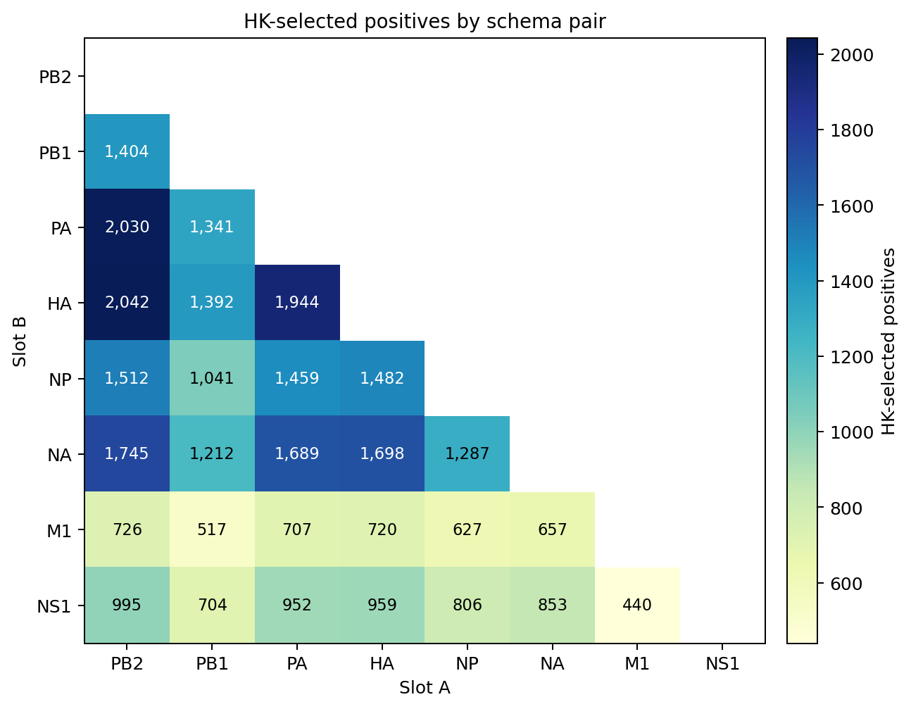
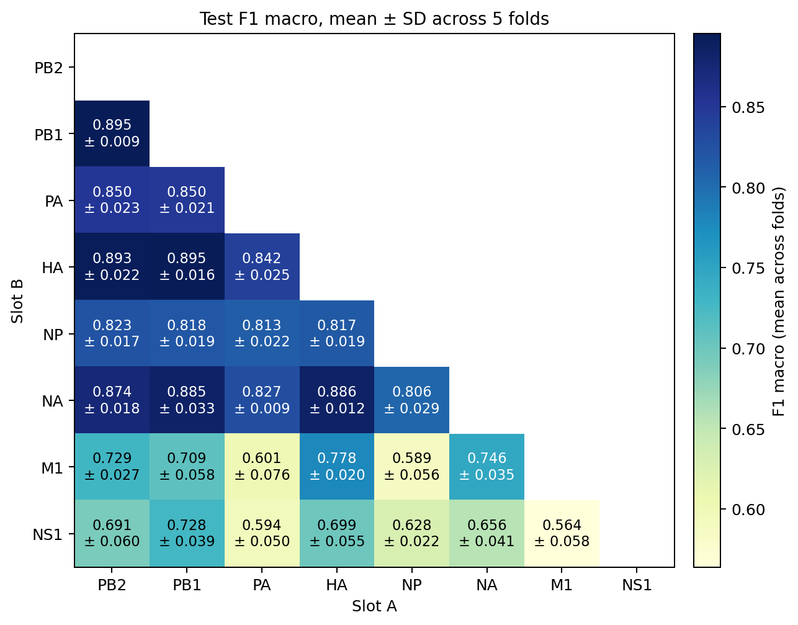
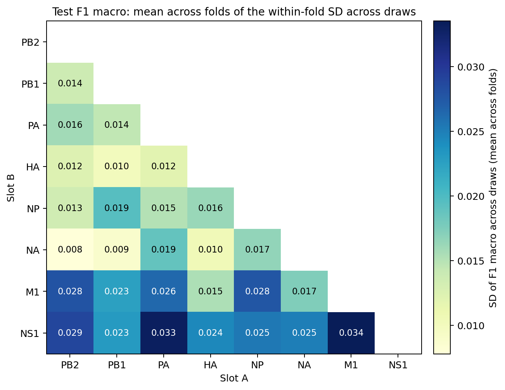

# Paper plan: influenza segment-pair classification

**Status: IN PROGRESS**

This plan is based on Jim's plan of 2026-10-08 (`plan-Jim-10-8-26-original.pdf`). That PDF is not
tracked in the repo.

Main parts:

1. Establish/Prove the methods on a small population (same host, subtype, year).
2. Expand the population. Evaluate across hosts, subtypes, and years.
3. Test on isolates from future years. E.g., train=[2015-2020], test=[2021-2025].

## Flu A data

- Curated dataset of GTO files: 108K isolates
- Each file contains: nucluotide (nt) sequences, amino-acid (aa) sequences,
  various metadata
- Positive pair: an observed same-isolate segment pair
- Negative pair: a pair not observed in any isolate in the corpus. A negative
  label does not establish biological incompatibility.

```text
        Slot A CDS                Slot B CDS
            |                         |
            v                         v
    generate features         generate features
            |                         |
            v                         v
           x_A                       x_B
            |                         |
            +------------+------------+
                         |
                         v
              concatenate: [x_A, x_B]
                         |
                         v
                LightGBM classifier
                         |
                         v
           probability of a positive pair
                         |
                         v
                     threshold
                         |
                         v
              predicted label: 1 or 0
```


# 1. Establish the methods on `Human-H3N2-2024`

**Status: IMPLEMENTED (2026-10-15).** The 28 datasets were built. All 140 `1A`
fits and all 1,400 `1B` redraw fits completed at commit `ba9b108`. The final
report is in `results/flu/July_2025/task1_28p_codon_matched_20261015_194607_report/`.

**Goal.** Establish the methods on a narrow population that contains a single
metadata group. This will help to decide which feature representations and
models to carry forward into Parts 2 and 3.


## Outline for Part 1

Each bullet names one item and the bracket gives the subsection that covers it.

**Scope.** One narrow population, 8 proteins, all 28 schema pairs, 5 fold CV.

**Dataset construction**

- [1A Methods] **Co-occurrence set**. Every sequence pair observed
  together in any isolate, corpus-wide. This set is used to block negatives.
- [1A Methods] **Deduplication**. The observed pairs are deduplicated on the
  `nt_cds` pair key, which is built from the two CDS nucleotide hashes. Two
  pairs with the same amino-acid (aa) sequences but different CDS sequences
  therefore count as two pairs, where an aa key would have counted them as one
  and dropped one of them.
- [1A Methods] **Positives**. Hopcroft-Karp (HK) selection on the deduplicated
  positives of the population, so no sequence appears more than once.
- [1A Methods] **CV**. 5-fold CV, assigned on positives.
- [1A Methods] **Negative sampling**. One matched, balanced-usage negative per
  positive in each split, with corpus co-occurrences blocked.
- [1A Methods] **Features**. Per-site codon, ordinal encoding, two slots
  concatenated. Width is the sum of the two sequences' codon counts.
- [1A Methods] For the report, not yet run: k-mer features on `nt_cds`, as
  a second arm. `TODO`

**Model development and evaluation**

- [1A Methods] LightGBM, 140 fits (28 pairs x 5 folds).
- [1A Results] The matrix reports F1 macro ± SD across the 5 folds.
- [1A Results] Table with all schema pairs and performance metrics.
- [1B Methods] Sensitivity from the draw of training negatives. For every fold,
  redraw the training negatives 10 times with seeds 42-51 and fit one model per
  draw: 1,400 fits (28 pairs x 5 folds x 10 redraws).
  - Fixed: training positives, val and test pairs, model seed
  - Changes: training negatives
- [1B Results] The per-pair within-fold SD of F1 macro across draws runs
  from 0.008 (PB2-NA) to 0.034 (M1-NS1).
- [1A Methods] Deferred for the paper: naive baselines, HPO, and whether
  the best HP settings shift across schema pairs.

**Post-hoc analysis**

- [Post-hoc, optional] Correlation of prediction performance (e.g., F1
  macro) with sample size (`HK selected`) and with sequence length (`Features`,
  the sum of the two proteins' codon counts). Both columns are already in
  `allpairs_summary.csv`. For the precedent, see Experiment 2 of
  `docs/plans/2026-09-14_codon_site_features_plan.md`, after its table.
- [Post-hoc, optional] Feature importance.


## 1A. Performance for All 28 Schema Pairs

**Goal.** Describe the dataset construction method and evaluate performance
across the 28 schema pairs.

### Dataset Construction (methods).

Build one dataset for each of the 28 pairs. For a each pair, we keep
`Human-H3N2-2024` isolates with complete CDS at their pinned lengths.
Pair the two sequences from each *eligible* isolate.
Deduplicate these positives by the `nt_cds` pair key, made from the two CDS
nucleotide hashes. Thus, different CDS sequences remain distinct even if they
encode the same protein sequence. Run Hopcroft-Karp (HK) on the deduplicated
pairs to select the largest set in which each CDS sequence occurs at most once
in each slot. Each schema pair retains all of its HK-selected positives; pairs
are not downsampled to a common size. The selected counts range from 440 for
M1-NS1 to 2,042 for PB2-HA.

The flowchart shows the order of operations (the counts are for PB1-HA, fold 0).

```text
[1] Build the negative blocker from the whole corpus (co-occurrence set)
    Input:  108,530 corpus isolates
    Action: collect the same-isolate nt_cds pair key from each
    Output: 82,657 distinct observed pair keys ───────────────────────┐
                                                                      │
[2] Filter the population                                             │
    Input:  108,530 corpus isolates                                   │
    Action: keep Human, H3N2, 2024                                    │
    Output: 5,346 isolates                                            │
              ↓                                                       │
[3] Require an eligible PB1-HA pair                                   │
    Input:  5,346 isolates                                            │
    Action: require both proteins with complete CDS at pinned lengths │
    Output: 2,945 eligible isolates                                   │
              ↓                                                       │
[4] Deduplicate positives                                             │
    Input:  2,945 eligible isolates                                   │
    Action: keep one row per nt_cds pair key                          │
    Output: 2,327 unique positive pairs                               │
              ↓                                                       │
[5] Select positives with HK                                          │
    Input:  2,327 unique positive pairs                               │
    Action: use each CDS sequence at most once per slot               │
    Output: 1,392 selected positives                                  │
              ↓                                                       │
[6] Make 5 CV folds                                                   │
    Input:  1,392 selected positives                                  │
    Action: assign test pairs; split the remainder into train/val     │
    Output: train/val/test = 973/140/279 positives                    │
              ↓                                                       │
[7] Draw negatives                                                    │
    Input:  split positives + observed pair keys from [1] <───────────┘
    Action: one matched, one-use negative per positive
    Output: train/val/test = 973/140/279 negatives
              ↓
[8] Combine negatives and positives
    Input:  split positives from [6] and split negatives from [7]
    Action: combine and assign labels 0 to negatives and 1 to positives
    Output: train/val/test = 1,946/280/558 pairs
```

1. **Blocker.** The whole corpus contains 108,530 same-isolate PB1-HA pairs.
   Deduplicating their `nt_cds` pair keys leaves 82,657 distinct keys. Step 7
   rejects any negative candidate with one of these keys.
2. **Population.** Filters records to retain specific host, subtype and year.
   This results in 5,346 isolates/positives for PB1-HA.
3. **Eligibility.** Keep isolates that have complete CDS at its pinned length
   for both PB1 and HA (2,277 nt and 1,701 nt, respectively).
   This results in 2,945 isolates/positives for PB1-HA.
4. **Deduplication.** Collapse identical CDS pair keys across those isolates.
   This results in 2,327 distinct positives for PB1-HA (618 pairs dropped).
5. **HK selection.** Find a maximum-size set of positives with one use per CDS
   sequence in each slot. This means a sequence appears at most once in a
   positive pair per slot across the dataset.
   This results in 1,392 isolates/positives for PB1-HA.
6. **CV split.** Assign selected positives to 5 test folds. Split the remaining
   positives into train and val sets for each fold.
   This results in train/val/test = 973/140/279 positives.
7. **Negative draw.** Draw negatives inside each split, using only sequences
   from that split's positives (sampler: `matched_balanced_usage_negatives`).
   - Reject:
      - observed corpus co-occurrences (the negative blocker set)
      - negatives already drawn in the fold
   - Every sequence appears both in a positive and negative pair.
8. **Combine pairs.** Add the negatives from step 7 to the positives in each
   split. Label positives 1 and negatives 0. For PB1–HA fold 0, this gives
   1,946 training, 280 validation, and 558 test pairs.


### Dataset Construction (results).

The numbers below show the final positive count for each of the 28 schema pairs
(right before CV splitting). The table gives the counts from the dataset
construction steps: `Eligible isolates` is step 3, `Unique positives` is step 4,
and `HK selected` is step 5 (aggregated in `allpairs_summary.csv`).



**Table:**

`Unique positives` counts distinct `nt_cds` pair keys. `Unique A` and
`Unique B` count distinct CDS sequences among those pairs, before HK selection.
The `HK selected` is the set of positives for each schema pair.

| # | Pair ID | Schema pair | Eligible isolates | Unique positives | Unique A | Unique B | HK selected |
|---:|---|---|---:|---:|---:|---:|---:|
| 1 | 1-2 | PB2-PB1 | 2,945 | 2,349 | 1,788 | 1,790 | 1,404 |
| 2 | 1-3 | PB2-PA | 5,324 | 3,837 | 2,808 | 2,712 | 2,030 |
| 3 | 1-4 | PB2-HA | 5,329 | 3,796 | 2,810 | 2,681 | 2,042 |
| 4 | 1-5 | PB2-NP | 5,318 | 3,484 | 2,800 | 1,830 | 1,512 |
| 5 | 1-6 | PB2-NA | 5,167 | 3,532 | 2,745 | 2,203 | 1,745 |
| 6 | 1-7 | PB2-M1 | 5,332 | 3,128 | 2,813 | 812 | 726 |
| 7 | 1-8 | PB2-NS1 | 5,313 | 3,204 | 2,800 | 1,120 | 995 |
| 8 | 2-3 | PB1-PA | 2,939 | 2,332 | 1,786 | 1,710 | 1,341 |
| 9 | 2-4 | PB1-HA | 2,945 | 2,327 | 1,790 | 1,756 | 1,392 |
| 10 | 2-5 | PB1-NP | 2,942 | 2,162 | 1,787 | 1,227 | 1,041 |
| 11 | 2-6 | PB1-NA | 2,939 | 2,237 | 1,786 | 1,480 | 1,212 |
| 12 | 2-7 | PB1-M1 | 2,945 | 1,992 | 1,790 | 582 | 517 |
| 13 | 2-8 | PB1-NS1 | 2,937 | 2,029 | 1,788 | 781 | 704 |
| 14 | 3-4 | PA-HA | 5,329 | 3,805 | 2,711 | 2,682 | 1,944 |
| 15 | 3-5 | PA-NP | 5,318 | 3,455 | 2,703 | 1,832 | 1,459 |
| 16 | 3-6 | PA-NA | 5,167 | 3,520 | 2,649 | 2,202 | 1,689 |
| 17 | 3-7 | PA-M1 | 5,335 | 3,082 | 2,716 | 812 | 707 |
| 18 | 3-8 | PA-NS1 | 5,315 | 3,214 | 2,705 | 1,121 | 952 |
| 19 | 4-5 | HA-NP | 5,323 | 3,382 | 2,673 | 1,830 | 1,482 |
| 20 | 4-6 | HA-NA | 5,173 | 3,466 | 2,634 | 2,203 | 1,698 |
| 21 | 4-7 | HA-M1 | 5,338 | 3,018 | 2,686 | 811 | 720 |
| 22 | 4-8 | HA-NS1 | 5,318 | 3,151 | 2,676 | 1,119 | 959 |
| 23 | 5-6 | NP-NA | 5,162 | 3,091 | 1,794 | 2,197 | 1,287 |
| 24 | 5-7 | NP-M1 | 5,326 | 2,356 | 1,833 | 808 | 627 |
| 25 | 5-8 | NP-NS1 | 5,307 | 2,540 | 1,824 | 1,114 | 806 |
| 26 | 6-7 | NA-M1 | 5,176 | 2,620 | 2,206 | 800 | 657 |
| 27 | 6-8 | NA-NS1 | 5,156 | 2,794 | 2,196 | 1,092 | 853 |
| 28 | 7-8 | M1-NS1 | 5,323 | 1,840 | 806 | 1,122 | 440 |

- All pairs have around 5K eligible isolates, except the 7 pairs that contain
  PB1, which have around 3K
- Only 55% of the isolates carry a complete PB1 CDS (at 2,277-nt length); step 3
- Almost all of the incomplete PB1 CDS are 2,274-nt. This is one codon short of
  the 2,277-nt length. Is the terminal stop just missing?

Sources:
- `docs/results/2026-09-07_cds_length_survey.md`
- `docs/results/2026-09-08_cds_pair_capacity.md`

**HK selection.** For each schema pair, we deduplicate the positives and then
keep the largest subset in which no CDS sequence appears twice in the same slot.
To do this we build a bigraph (bipartite graph). One side has the unique slot-A
sequences, the other side has the unique slot-B sequences, and each positive is
an edge between its two sequences (PB1-HA: 1,790 slot-A nodes, 1,756 slot-B
nodes, 2,327 edges).
A set of edges with no shared node is a matching, and it corresponds exactly to
a set of positives with no sequence reused in either slot. The Hopcroft-Karp (HK)
algorithm finds a maximum matching, meaning one with as many edges as possible.
For PB1-HA it keeps 1,392 positives. More than one maximum matching can exist,
but they all have the same size, so the number kept depends only on the data and
not on row order. We use networkx's `matching.hopcroft_karp_matching`.
Sequences and edges are sorted before the call, so the same matching is returned
on every run.


### Model Development and Evaluation.

#### Feature Representation

##### Codon-encoding CDS (`nt_cds`):

- Split each complete CDS into codons and encode one integer ID per codon site.
  Concatenate the slot A and B vectors.
- The IDs come from `genslm_vocab/tokenizer_config.json`.
- LightGBM treats each codon site as categorical nominal (with `categorical_feature`).
- The width of the concatenated vectors is the sum of their codon counts.
- Why codon-encoding:
  - GenSLM
  - feature importance `docs/plans/2026-09-14_codon_site_features_plan.md`
  - Nucleotide site-encoding outperformed k-mers on a subset of schema pairs that we explored `docs/results/2026-09-08_h3n2_2024_progress_report.md`

#### Training and Evaluation

- 28 pairs x 5 folds --> 140 model trainings
- LightGBM classifier (classification threshold of 0.5)
- F1 macro, Precision, Recall, AUC-ROC, AUC-PR, Brier


#### Results




**Table:**
- The pairs are ranked by F1 macro averaged across the 5 folds
- The dataset size per schema pair is 2 x `Positives`; `Positives` is the
`HK selected` column from the previous table (i.e., after filtering and dedup)

| Rank | Pair ID | Schema pair | Positives | Features | F1 macro | Precision | Recall | AUC-ROC | AUC-PR | Brier |
|---:|---|---|---:|---:|---:|---:|---:|---:|---:|---:|
| 1 | 1-2 | PB2-PB1 | 1,404 | 1,519 | 0.895 ± 0.009 | 0.859 ± 0.012 | 0.947 ± 0.015 | 0.944 ± 0.007 | 0.923 ± 0.018 | 0.121 ± 0.034 |
| 2 | 2-4 | PB1-HA | 1,392 | 1,326 | 0.895 ± 0.016 | 0.858 ± 0.010 | 0.948 ± 0.038 | 0.948 ± 0.007 | 0.928 ± 0.009 | 0.104 ± 0.029 |
| 3 | 1-4 | PB2-HA | 2,042 | 1,327 | 0.893 ± 0.022 | 0.847 ± 0.028 | 0.963 ± 0.012 | 0.941 ± 0.014 | 0.918 ± 0.020 | 0.099 ± 0.029 |
| 4 | 4-6 | HA-NA | 1,698 | 1,037 | 0.886 ± 0.012 | 0.843 ± 0.011 | 0.950 ± 0.013 | 0.940 ± 0.012 | 0.918 ± 0.019 | 0.099 ± 0.015 |
| 5 | 2-6 | PB1-NA | 1,212 | 1,229 | 0.885 ± 0.033 | 0.849 ± 0.037 | 0.938 ± 0.027 | 0.929 ± 0.023 | 0.900 ± 0.018 | 0.125 ± 0.039 |
| 6 | 1-6 | PB2-NA | 1,745 | 1,230 | 0.874 ± 0.018 | 0.831 ± 0.023 | 0.942 ± 0.017 | 0.933 ± 0.012 | 0.913 ± 0.020 | 0.108 ± 0.015 |
| 7 | 1-3 | PB2-PA | 2,030 | 1,477 | 0.850 ± 0.023 | 0.810 ± 0.033 | 0.919 ± 0.008 | 0.929 ± 0.013 | 0.914 ± 0.018 | 0.118 ± 0.013 |
| 8 | 2-3 | PB1-PA | 1,341 | 1,476 | 0.850 ± 0.021 | 0.800 ± 0.020 | 0.936 ± 0.026 | 0.918 ± 0.017 | 0.896 ± 0.025 | 0.121 ± 0.015 |
| 9 | 3-4 | PA-HA | 1,944 | 1,284 | 0.842 ± 0.025 | 0.798 ± 0.030 | 0.919 ± 0.016 | 0.917 ± 0.016 | 0.892 ± 0.014 | 0.122 ± 0.014 |
| 10 | 3-6 | PA-NA | 1,689 | 1,187 | 0.827 ± 0.009 | 0.782 ± 0.010 | 0.911 ± 0.011 | 0.905 ± 0.004 | 0.877 ± 0.013 | 0.134 ± 0.010 |
| 11 | 1-5 | PB2-NP | 1,512 | 1,259 | 0.823 ± 0.017 | 0.759 ± 0.018 | 0.954 ± 0.003 | 0.901 ± 0.015 | 0.880 ± 0.017 | 0.138 ± 0.020 |
| 12 | 2-5 | PB1-NP | 1,041 | 1,258 | 0.818 ± 0.019 | 0.769 ± 0.018 | 0.916 ± 0.024 | 0.900 ± 0.016 | 0.886 ± 0.024 | 0.159 ± 0.026 |
| 13 | 4-5 | HA-NP | 1,482 | 1,066 | 0.817 ± 0.019 | 0.765 ± 0.021 | 0.923 ± 0.016 | 0.898 ± 0.011 | 0.875 ± 0.020 | 0.143 ± 0.018 |
| 14 | 3-5 | PA-NP | 1,459 | 1,216 | 0.813 ± 0.022 | 0.765 ± 0.021 | 0.907 ± 0.019 | 0.902 ± 0.016 | 0.889 ± 0.016 | 0.136 ± 0.010 |
| 15 | 5-6 | NP-NA | 1,287 | 969 | 0.806 ± 0.029 | 0.751 ± 0.031 | 0.927 ± 0.011 | 0.888 ± 0.021 | 0.864 ± 0.023 | 0.144 ± 0.020 |
| 16 | 4-7 | HA-M1 | 720 | 820 | 0.778 ± 0.020 | 0.727 ± 0.023 | 0.904 ± 0.029 | 0.855 ± 0.020 | 0.833 ± 0.024 | 0.188 ± 0.020 |
| 17 | 6-7 | NA-M1 | 657 | 723 | 0.746 ± 0.035 | 0.698 ± 0.041 | 0.901 ± 0.042 | 0.842 ± 0.030 | 0.809 ± 0.030 | 0.184 ± 0.013 |
| 18 | 1-7 | PB2-M1 | 726 | 1,013 | 0.729 ± 0.027 | 0.680 ± 0.024 | 0.894 ± 0.028 | 0.812 ± 0.013 | 0.790 ± 0.016 | 0.198 ± 0.020 |
| 19 | 2-8 | PB1-NS1 | 704 | 990 | 0.728 ± 0.039 | 0.687 ± 0.039 | 0.859 ± 0.027 | 0.823 ± 0.032 | 0.815 ± 0.030 | 0.193 ± 0.011 |
| 20 | 2-7 | PB1-M1 | 517 | 1,012 | 0.709 ± 0.058 | 0.666 ± 0.047 | 0.897 ± 0.045 | 0.799 ± 0.055 | 0.770 ± 0.055 | 0.214 ± 0.021 |
| 21 | 4-8 | HA-NS1 | 959 | 798 | 0.699 ± 0.055 | 0.657 ± 0.043 | 0.891 ± 0.014 | 0.789 ± 0.044 | 0.776 ± 0.040 | 0.197 ± 0.012 |
| 22 | 1-8 | PB2-NS1 | 995 | 991 | 0.691 ± 0.060 | 0.657 ± 0.053 | 0.851 ± 0.054 | 0.789 ± 0.052 | 0.781 ± 0.055 | 0.198 ± 0.019 |
| 23 | 6-8 | NA-NS1 | 853 | 701 | 0.656 ± 0.041 | 0.626 ± 0.033 | 0.826 ± 0.032 | 0.760 ± 0.042 | 0.749 ± 0.043 | 0.216 ± 0.012 |
| 24 | 5-8 | NP-NS1 | 806 | 730 | 0.628 ± 0.022 | 0.602 ± 0.015 | 0.846 ± 0.031 | 0.719 ± 0.037 | 0.714 ± 0.040 | 0.221 ± 0.009 |
| 25 | 3-7 | PA-M1 | 707 | 970 | 0.601 ± 0.076 | 0.591 ± 0.044 | 0.894 ± 0.046 | 0.710 ± 0.058 | 0.698 ± 0.056 | 0.222 ± 0.018 |
| 26 | 3-8 | PA-NS1 | 952 | 948 | 0.594 ± 0.050 | 0.581 ± 0.030 | 0.868 ± 0.025 | 0.701 ± 0.051 | 0.694 ± 0.051 | 0.224 ± 0.012 |
| 27 | 5-7 | NP-M1 | 627 | 752 | 0.589 ± 0.056 | 0.581 ± 0.040 | 0.850 ± 0.070 | 0.694 ± 0.046 | 0.681 ± 0.044 | 0.229 ± 0.009 |
| 28 | 7-8 | M1-NS1 | 440 | 484 | 0.564 ± 0.058 | 0.564 ± 0.034 | 0.848 ± 0.055 | 0.683 ± 0.064 | 0.684 ± 0.062 | 0.231 ± 0.007 |

**Results Summary**:

- Mean F1 macro on test set ranges: **0.564** for M1–NS1 (row 28) to **0.895**
  for PB2–PB1 (row 1)
- The SD across folds ranges: **0.009** for PB2–PB1 (row 1) to **0.076** for
  PA–M1 (row 25) (0.9 to 7.6 percentage points).
- At the fixed 0.5 threshold, Recall exceeds Precision for all 28 pairs.
- All 13 pairs containing M1 or NS1 ranked below the other 15 pairs by F1 macro.
  Subtype and collection date prediction tasks also show weaker results for
  segments 7 and 8.
- AUC-ROC and AUC-PR rank the pairs similarly (Spearman 0.99).
- Brier measures the error in the predicted probabilities. It depends on the
  probabilities themselves, not on the classification threshold (F1, precision,
  recall) or on the ranking (AUC-ROC, AUC-PR). A model that predicts 0.5 for
  every pair scores 0.25 on a balanced test set.
- Mean Brier and F1 macro are strongly inversely correlated (Spearman -0.97).
  M1-NS1 scores 0.231 (close to that 0.25 reference) and its test predictions
  cluster near 0.5. Brier alone cannot distinguish weak discrimination from
  miscalibration.
- A high Brier does not by itself mean weak classification. A model that
  predicted 0.51 for every positive and 0.49 for every negative would score 1.0
  on the other five metrics at the 0.5 threshold, and 0.24 on Brier.

**`TODO`**:

* Other features:
  * Site-level nucleotide encoding of CDS.
  * Nucleotide k-mer counts from CDS.


## 1B. Sensitivity to the Sampling of Training Negatives

**Goal.** The training positives of a split are determined by the data, but the
training negatives are sampled from a much larger set of possible negative
pairs. Measure how much test set prediction performance varies when models are
trained on different sets of negatives and evaluated on the same test pairs.

**Methods.**
- We start with the 5-fold datasets generated in `1A`.
- For every fold, redraw the training negatives `r`=10 times, each time with a
  different random seed, and train one model per draw. What remains fixed:
  training positives, val and test sets, LightGBM seed. This results in `r`
  models per fold.
- Across 28 pairs and 5-folds, `r = 10` draws per fold produce 1,400 sampled
  training negative sets and 1,400 trained models (28 pairs × 5 folds × 10
  draws).
- Each of the `r` models predicts the same test pairs. This results in `r`=10
  predictions for each test pair.

**Results.** The table shows **fold 0** for each pair, sorted by mean F1 macro.
Each F1 value is the mean ± SD of the 10 test scores, one from each negative
draw (other folds are in `redraw_by_pair_fold.csv`).

How to read the table:

- Fold 0 has 10 models, one per negative draw with different seeds. All 10 are
  scored on the same test pairs. E.g., PB1-HA fold 0 has 558 test pairs (279
  pos and 279 neg), and 1946 train pairs (973 pos and 973 neg per draw).
- Column `F1 macro`. How much does test performance change when the training
  negatives change?
  E.g., 0.909 ± 0.007 is the F1 mean ± SD over the 10 models.
  The ± is the spread across negative draws (not across folds as in `1A`).
- Column `prob SD pos / neg`. How much does test set probability change 
  in each class?
  E.g., 0.051 / 0.057. Here, each test pair gets one SD value, computed
  from its 10 probabilities. 0.051 is the median of these SDs over the
  positive test pairs, and 0.057 is the median over the negative test pairs.

| # | Pair ID | Schema pair | F1 macro | prob SD pos / neg |
|---:|---|---|---:|---:|
| 1 | 2-4 | PB1-HA | 0.909 ± 0.007 | 0.051 / 0.057 |
| 2 | 1-4 | PB2-HA | 0.894 ± 0.010 | 0.059 / 0.061 |
| 3 | 2-6 | PB1-NA | 0.894 ± 0.009 | 0.061 / 0.068 |
| 4 | 1-2 | PB2-PB1 | 0.885 ± 0.015 | 0.071 / 0.079 |
| 5 | 4-6 | HA-NA | 0.868 ± 0.020 | 0.072 / 0.086 |
| 6 | 1-3 | PB2-PA | 0.863 ± 0.007 | 0.045 / 0.048 |
| 7 | 1-6 | PB2-NA | 0.858 ± 0.007 | 0.058 / 0.070 |
| 8 | 3-4 | PA-HA | 0.857 ± 0.024 | 0.064 / 0.080 |
| 9 | 2-3 | PB1-PA | 0.836 ± 0.020 | 0.053 / 0.056 |
| 10 | 3-6 | PA-NA | 0.831 ± 0.009 | 0.046 / 0.048 |
| 11 | 4-5 | HA-NP | 0.824 ± 0.008 | 0.057 / 0.055 |
| 12 | 5-6 | NP-NA | 0.815 ± 0.006 | 0.039 / 0.047 |
| 13 | 2-5 | PB1-NP | 0.814 ± 0.020 | 0.045 / 0.054 |
| 14 | 1-5 | PB2-NP | 0.813 ± 0.014 | 0.066 / 0.090 |
| 15 | 4-7 | HA-M1 | 0.795 ± 0.009 | 0.026 / 0.035 |
| 16 | 3-5 | PA-NP | 0.770 ± 0.023 | 0.055 / 0.077 |
| 17 | 4-8 | HA-NS1 | 0.759 ± 0.018 | 0.040 / 0.050 |
| 18 | 1-7 | PB2-M1 | 0.737 ± 0.031 | 0.036 / 0.049 |
| 19 | 1-8 | PB2-NS1 | 0.732 ± 0.023 | 0.030 / 0.042 |
| 20 | 6-7 | NA-M1 | 0.703 ± 0.018 | 0.030 / 0.033 |
| 21 | 2-8 | PB1-NS1 | 0.696 ± 0.016 | 0.026 / 0.030 |
| 22 | 2-7 | PB1-M1 | 0.678 ± 0.023 | 0.028 / 0.028 |
| 23 | 6-8 | NA-NS1 | 0.662 ± 0.032 | 0.030 / 0.033 |
| 24 | 7-8 | M1-NS1 | 0.651 ± 0.041 | 0.011 / 0.016 |
| 25 | 5-8 | NP-NS1 | 0.630 ± 0.030 | 0.021 / 0.025 |
| 26 | 3-8 | PA-NS1 | 0.597 ± 0.031 | 0.019 / 0.022 |
| 27 | 5-7 | NP-M1 | 0.567 ± 0.031 | 0.012 / 0.013 |
| 28 | 3-7 | PA-M1 | 0.507 ± 0.015 | 0.014 / 0.014 |

<!-- **Matrix**. For each fold, compute the SD of test F1 macro across the 10
negative draws. Each matrix cell is the mean of those 5 SDs. This shows how
much F1 changes when we sample different training negatives for the same fold.
In 1A, the SD is across folds, where the training and test pairs also change.

 -->

### Open questions

- Should the redraw seeds start at 0, so that they match the fold ids, instead of running 42-51?
- The 2,274-nt PB1 records end exactly where their contig ends, with no contig
  bases after the CDS in all but one case, so the bases that would complete the
  CDS were never assembled. Ask whoever produced the GTO annotations whether
  such a record should count as the same PB1 form as a 2,277-nt one, which
  would recover around 2,400 isolates.


## Implementation record

Experiments 1, 2 and 6 in `docs/plans/2026-09-14_codon_site_features_plan.md` supplied the
initial 28-pair screen and training-negative redraws. Task 1 added 5-fold experiment specs,
manifest-based dataset and fit selection, strict config and input checks, a 28-pair audit and
report, and a redraw coordinator. The final matched-negative spec is
`conf/experiments/human_h3n2_2024_28p_codon_matched_cv5.yaml`.

`scripts/run_allpairs_datasets.py` built the 28 datasets;
`src/analysis/audit_pair_datasets.py` audited them;
`scripts/run_allpairs_baselines.py` ran `1A`;
`scripts/run_allpairs_balanced_redraws.py` ran `1B`; and
`src/analysis/aggregate_allpairs_results.py --final` produced the report. The dataset, training
and redraw manifests record the selected runs, settings, code commit and input checksums. The
reported datasets and all fits used commit `ba9b108`.

- dataset prefix `task1_28p_codon_matched_20261015_194607_`
- `1A` training run `task1_28p_codon_matched_20261015_194607_lgbm_20261015_195321`
- `1B` redraw dataset prefix `task1_28p_codon_matched_20261015_194607_negredraw_20261015_200417_`
- `1B` redraw training run `task1_28p_codon_matched_20261015_194607_negredraw_20261015_200417_lgbm`
- report for `1A` and `1B`: `results/flu/July_2025/task1_28p_codon_matched_20261015_194607_report/`

Each redraw drew its negatives with `matched_balanced_usage_negatives`, the sampler the source
datasets were built with.


# 2. Expand the population. Evaluate across hosts, subtypes, and years.

**Status: IMPLEMENTED (2026-10-15).** The 21 datasets were built and audited. All 105 five-fold
LightGBM fits completed at commit `8b604ed`. The final report is in
`results/flu/July_2025/task2_21p_codon_matched_20261015_151826/`.

This run replaced a first one built on 2026-10-14 at commit `7d7b3b6`, so that Task 2 and Task 1
share both the negative sampler and the corpus-wide co-occurrence blocking set. The rebuild used
the same population, seed, sampler and spec, and the audit confirmed each pair's pooled positive
test pair keys against the earlier build. It changed no positive and 1,795 of the 382,885 saved
negatives, in 6 of the 21 pairs. Those 6 pairs are the only ones whose scores moved, by at most
0.0042 F1 macro, which is inside every pair's fold SD. The earlier run's outputs are kept in
`results/flu/July_2025/task2_21p_codon_matched_20261014_090208/`.

**Goal.** Train on a *population* containing several hosts, HN subtypes or years, and measure
performance within each *metadata group*.

* *Population*: a dataset containing all the isolates selected by the dataset filters.
* *Metadata group*: a dataset subset with one exact `(host, HN subtype, year)` combination.

Task 1 set the dataset filters to (Human, H3N2, 2024), so its population held one metadata group.
The Task 2 population holds several metadata groups, and its reports distinguish the two terms.

**Methods.** The build filters to the eight groups below, excluding isolates missing host, HN
subtype or year. `filter_by_metadata` keeps only values in the three filter lists. The Task 2
experiment spec sets `dataset.n_folds=5` for both dataset building and training; the bundles retain
their inherited four-fold setting. Positives are selected by Hopcroft–Karp after global pair-key
deduplication. Each split receives one matched balanced-usage negative per positive. Its two
sequences come from different selected positives in the same split and metadata group. The sampler
matches exact years with `year_match: exact`, rather than the default year bins. The saved negative
rows were checked using both endpoints' isolate metadata, not just the requested regime target or
the `neg_regime` field. The implementation is described below.

**Reports.** `allpairs_summary.csv` gives one row per schema pair for the whole population.
`src/analysis/metadata_group_report.py` writes `metadata_group_counts.csv` from saved train,
validation and test pairs, with positive and negative counts by schema pair, fold, split and group.
The counts sum to each split's totals. It writes `test_metrics_by_metadata.csv` from each fold's
`test_predicted.csv`, using that model's decision threshold. Its 1,470 rows cover the eight joint
groups and six pooled host, subtype or year values for each of 21 pairs and five folds. Each row
contains the group values, class counts, confusion counts, F1 macro, AUC-ROC, precision and recall.
All metric rows in this run have both classes. If another run has a one-class group, its metrics
are NaN for that fold. The figure code excludes those folds from its mean and shows how many folds
contributed.

The report contains four figures: `matrix_f1_macro.png` for the whole population,
`metrics_by_group_f1_macro.png` for the eight joint groups,
`metrics_by_axis_f1_macro.png` for six pooled values, and `counts_by_group.png` for test positives
summed over folds. The metric figures show each cell's fold mean above its fold SD and share a
color scale. `--metric` can draw other supported metrics. `--min_test_pairs` can mask thin group
cells; its default of 0 left every cell visible in this report. Figure titles and CSV rows identify
the population. NS1 and its seven schema pairs are excluded for the reason below.

### The Task 2 population

The build uses `[Human, Pig]`, `[H3N2, H1N1]`, `[2022, 2023]`. All eight metadata groups have isolates:
10,992 in total, from 4,864 in Human-H3N2-2022 down to 157 in Pig-H3N2-2022. The measurements
behind this choice are in `results/flu/July_2025/pair_capacity_task2_2x2x2/`, under
`cds_length_survey_grid/` for each group on its own and `cds_length_survey_candidates/` for the
pooled population.

This population supports the 21 schema pairs among PB2, PB1, PA, HA, NP, NA and M1. It does not
support the seven pairs that contain NS1. Per-site codon features need one pinned CDS length per
protein, and NS1 has two lengths here: 693 nt in Human-H3N2 and 660 nt in the other three host and
subtype combinations. The two counts are close, at 1,552 of the 3,062 unique complete sequences on
693 nt and 1,485 on 660 nt, so neither length reaches the 0.90 share of unique complete sequences
that `check_cds_length` requires. The lengths are 231 and 220 codons, so they differ in the protein
itself rather than in sequence quality, and no single pin covers both. Excluding NS1 is the cost of
keeping Human-H3N2 in the population. Task 1 reports all 28 pairs on its own population, so Task 2
does not repeat that.

The year choice is what allows a single PB1 pin. Human-H3N2 PB1 is 2,274 nt through 2023 and
2,277 nt in 2024 and 2025, while every other population in the survey stays at 2,274 nt in every
year measured. Over 2022-2023, all eight groups have 2,274 nt as their own modal length and the
pooled share at that length is 0.912, so the pin holds. Adding 2024 drops that share to 0.782,
which fails the check. Using 2021-2022 instead raises it to 0.944, but Human-H1N1-2021 has only
11 isolates.

The pins are PB2 2,280, PB1 2,274, PA 2,151, HA 1,701, NP 1,497, NA 1,410 and M1 759 nt.
`conf/bundles/flu_7_major_proteins_human_pig_h3n2_h1n1_2022_2023_pinned_length.yaml` sets the
three filters and overrides PB1 to 2,274 nt; `conf/virus/flu.yaml` supplies the other six pins.
The pair-capacity run uses this lower bundle. The master bundle
`conf/bundles/flu_21p_human_pig_h3n2_h1n1_2022_2023_site_codon.yaml` adds Hopcroft–Karp
selection, codon-site features and matched balanced-usage negatives. Its 21 children each set one
schema pair. The experiment spec
`conf/experiments/human_pig_h3n2_h1n1_2022_2023_21p_codon_matched_cv5.yaml` supplies five folds
and checks the settings used by the build and fits.

### Matched balanced-usage negatives

An ordinary balanced negative can join isolates from different groups. The matched sampler in
`src/datasets/_negative_sampling.py` instead assigns each selected positive to its retained source
isolate's group, then pairs slot-A and slot-B sequences from different positives within that group
and split. Global pair-key deduplication remains in place. If a sequence pair was observed in
several groups before deduplication, only its retained isolate's group receives it; the retained
isolate depends on input row order.

The Task 2 master sets all eight regime targets, with `host_subtype_year: 1.0` and the others zero,
plus `year_match: exact` and `on_shortfall: error`. The config guard accepts this profile with
`negative_scope: balanced`, three matching axes and a 1:1 negative ratio. It rejects other
`negative_sampling` profiles with balanced scope. Task 1's master bundle sets the same block since
2026-10-15, so both screens draw their negatives with this sampler. Task 1's population is one
metadata group, so the matching rules nothing out there; what it changes is the sampler, the
`neg_regime` and `metadata_match_count` columns on each negative row, and the build stopping rather
than warning when a group cannot give each of its sequences one negative use.

For each group and split, the sampler finds a one-to-one assignment from selected slot-A sequences
to selected slot-B sequences. It excludes observed positive pairs and negatives already drawn in
the fold. An augmenting-path search proves whether the assignment exists. A group with one
positive, no valid assignment, repeated selected sequences in a slot or more than 5,000 positives
raises an error naming the group and split. `duplicate_stats.json` records the group sizes and
successful negative counts. Each endpoint retains its own source isolate's metadata. Saved
negatives carry `neg_regime: host_subtype_year` and `metadata_match_count: 3`; the saved endpoint
metadata was checked independently for equal host, HN subtype and exact year.

### Observed results

The final report covers all 21 pairs and 105 completed fits, with no failed fits. The whole
population's fold-mean F1 macro ranged from 0.889 ± 0.013 for PB2-PA to 0.782 ± 0.012 for NA-M1.
All six M1 pairs ranked below the other 15. M1 also had the fewest unique slot sequences and the
smallest HK-selected sets; these results do not isolate sequence capacity as the cause of their
lower scores.

The following group values average the reported metrics over 21 pairs and five folds. Test
positives sum across the 21 pairs, with each positive appearing in one test fold. These are
descriptive means, not fitted comparisons among groups.

| Metadata group | F1 macro | AUC-ROC | Test positives |
|---|---:|---:|---:|
| Human-H3N2-2022 | 0.862 | 0.907 | 28,745 |
| Human-H1N1-2023 | 0.847 | 0.901 | 19,204 |
| Pig-H1N1-2022 | 0.840 | 0.900 | 3,239 |
| Human-H3N2-2023 | 0.837 | 0.889 | 8,441 |
| Human-H1N1-2022 | 0.825 | 0.872 | 5,711 |
| Pig-H3N2-2023 | 0.818 | 0.883 | 4,761 |
| Pig-H1N1-2023 | 0.818 | 0.878 | 4,784 |
| Pig-H3N2-2022 | 0.815 | 0.888 | 1,692 |

The largest and smallest group means differ by 0.047 F1 macro. The marginal means were Human
0.851 versus Pig 0.823, H3N2 0.851 versus H1N1 0.840, and 2022 0.852 versus 2023 0.840.
Group size did not order the scores: Pig-H1N1-2022 scored 0.840 on 3,239 test positives, while
Human-H1N1-2022 scored 0.825 on 5,711. The thinnest cells were Pig-H3N2-2022 on the six M1 pairs,
averaging 12.2 to 12.4 test positives per fold. The lowest single fold held 7 test positives, on
NP-M1. Small cells remain visible with their counts; the Pig-H3N2-2022 fold SD reached ±0.125 for
PB1-M1. No group was single-class in a test fold.

### Open questions

The first run used the builder's positive-pair fold assignment without metadata-group
stratification. It removed no group, masked no figure cell and scored every group. Matching was
feasible in all saved splits. The questions below concern possible changes for later populations
or for interpreting thin cells in this one.

1. **Small groups in the test split.** Folds are assigned by positive, not by metadata group. In
   this run Pig-H3N2-2022 averaged 12.2 NA-M1 test positives per fold, with 8 in its lowest fold,
   although all eight groups appeared in the test metrics. In another population, a group could
   have test positives but no training positives in a fold. That score would measure performance
   on an unseen group.
   The matching check does not catch this case because a training split with no positives in a
   group needs no negatives there. Options for a later run:
   - Stratify the folds by metadata group.
   - Set a minimum group size and do not score groups below it. `analyze_level2_by_axis` in
     `src/analysis/analyze_stage4_train.py` merges strata with fewer than 20 pairs into an
     `other` stratum. The report's `--min_test_pairs` option can mask group cells below a chosen
     threshold and state it in the figure title; no threshold was used here.
   - Score every group, but report the unseen-group scores separately.
     `metadata_group_counts.csv` gives each group's training positives per fold, so these scores
     can be flagged.
2. **A rule for removing small groups.** If a later run removes small groups, set the rule before
   creating the folds. Record the positives each group lost, by schema pair and metadata
   group. Never remove positives from just one split, because each positive has only one test
   fold. The CC builder likewise removes infeasible components before generating its splits.
   Removing groups can still leave a group with one positive in a validation or test split. If the
   matching check then fails, change the rule or the split and rebuild; do not patch one split.
   Do not call this rule an eligibility rule. In the glossary, *eligible isolates* are the isolates
   that carry a schema pair's required sequences, such as complete CDS at the pinned length.
3. **Coarser host labels.** Our metadata carries one host string per isolate, such as `Chicken`
   or `Mallard`, and most non-human hosts have too few isolates. Grouping them into a coarser label
   (especially `Avian`) would give a host group large enough to compare against `Human`. Marcus's
   paper reports performance over human, avian, environmental, sea-mammal, lab-derived and
   nonhuman-mammal samples, plus unknown and other. Jamie's paper uses human, swine, duck, chicken
   and other. We have no host-grouping map in the repo yet.


# 3. Test on future-year pairs

**Goal.** Train on past-year pairs and test on future-year pairs whose endpoint sequences were not
selected for training or validation. Report performance separately for each test year.

**Example run.** For one schema pair, use 2011–2013 as the past pool and 2014–2015 as the future
pool. Set `dataset.metadata_holdout.train: {year_range: [2011, 2013]}` and
`dataset.metadata_holdout.test: {year_range: [2014, 2015]}`. These are example years; choose a
population with enough selected positives in each split before fixing the experiment bundle. Use
the same sequence filters and `pair_key_alphabet` in both pools. The Task 1/2 codon setting uses
`nt_cds`.

1. Build positive candidates from the past pool only. Deduplicate by `pair_key`, then run
   Hopcroft–Karp (HK) once on those candidates. Randomly assign `dataset.val_ratio` of the selected
   positives to validation with a recorded seed; the rest go to training. Freeze both sets.
2. Build positive candidates from both future years. Drop a candidate if its slot-A sequence was
   selected in past training or validation, or if its slot-B sequence was selected there. Compare
   hashes in the configured `pair_key_alphabet`. Deduplicate the remaining future candidates by
   `pair_key`, then run HK once across both future years. These selected pairs form the test set;
   future selection cannot change the frozen past positives.
3. Assert that no selected `pair_key`, slot-A hash or slot-B hash occurs in more than one split.
   Record candidate, deduplicated, excluded-for-past-overlap and HK-selected counts by period.
   Also report HK-selected counts by test year. Use the source year of each retained positive for
   its test-year group.
4. Draw 1:1 balanced-usage negatives separately in each split. Use Task 2's matched profile so
   both endpoints of each negative share host, HN subtype and exact year. Fail with the split and
   group named if a one-use matching cannot be made. Train one model on the past training set,
   select its settings on past validation, and evaluate it once on the combined future test set.

**Required code changes.**
- Add a single-split temporal HK path and allow active `positive_pair_selection` with
  `metadata_holdout` and `dataset.n_folds: 1`. The current validator requires at least two folds
  for active selection. The current holdout path divides past isolates into train and validation
  before positive selection, so it must instead divide the past HK-selected pairs afterward.
- Build and select past positives before examining future candidates. Do not globally deduplicate
  positive pairs across both periods or rerun HK on their union. Reuse the positive selector and
  the existing prepartitioned-positive input to `split_dataset_v2` for negative sampling and
  audits. Save the period-specific selection counts and cross-split overlap checks.
- Negatives are already blocked in every split against a corpus-wide co-occurrence set, so this
  needs no Task 3 work. `_pair_helpers.build_corpus_cooccurrence_set` builds it on the two
  proteins of the schema pair and the configured `pair_key_alphabet`, reading the alphabet's own
  `*_final` table, so neither the population filters nor the pinned-length filter narrow it. A
  sequence pair observed together anywhere in the corpus never receives a negative label, in the
  test split as well as in training. The set spans both periods, so a co-occurrence first seen in
  a future isolate can reject a past training negative. That is accepted here: it only removes
  candidate negatives and corrects labels, and it never puts information about a test pair into a
  training row. The scope and size are recorded with the dataset statistics as
  `co_occurrence_blocking.scope` and `total_cooccur_pairs`, and the audit count of observed
  positives labeled negative is measured against this set.
- Add a bundle and experiment spec for the chosen years and pair. Exercise the single-split
  dataset audit, fit runner and aggregator end to end; adjust any fold-count assumptions or
  figure labels that call a single holdout `CV`. The existing temporal HA-NA bundle uses a
  different year window and does not select HK positives.
- Use the existing year rows in `test_metrics_by_metadata.csv` for per-test-year scores. Add a
  plot of F1 macro against test year from this one held-out model; `plot_year_sweep.py` reads
  separate random-split runs and does not draw this result.

**Results.** Report test positives, negatives, F1 macro and AUC-ROC for 2014 and 2015, alongside
the combined test score. Plot F1 macro by test year with the counts visible. This single split
has no across-fold SD. A difference between the two years describes this held-out test set; it
does not isolate elapsed time from changes in the sampled sequences or metadata groups.

**Notes.**
- The corpus-wide blocking set changes few labels. Checked directly against the Task 2 run
  `task2_21p_codon_matched_20261014_090208_*`, 6 of 382,885 saved negatives across 21 pairs and 5
  folds are corpus co-occurrences, and in the Task 1 run
  `h3n2_2024_28p_codon_cv5_20261009_141504_*`, 6 of 164,705 across 28 pairs and 5 folds, with
  per-pair counts of 0 or 1. On the Task 2 population, the sequence pairs that co-occur outside
  that population while both of their sequences are present inside it number 68 for PB2-NP, 129
  for NP-M1, 69 for HA-NA and 47 for PB2-PB1, against slot universes of 12 to 33 million candidate
  cells. Under uniform draws that is 0.01 to 0.06 expected mislabeled negatives per split. These
  counts use complete CDS at the modal length per protein in place of the pin, so they are
  candidate counts rather than counts from a build.
- A single split is `dataset.n_folds: null` in both existing holdout bundles. The validator
  accepts null or 1, so the Task 3 bundle should state which one it uses.
- Validation drives LightGBM early stopping on AUC, over 50 rounds by default. The decision
  threshold stays at 0.5, because `conf/training/base.yaml` sets `threshold_metric: null`. A fixed
  threshold is what lets F1 macro drift when the score distribution shifts between years while
  AUC-ROC holds, which is the reason to report both.
- `dataset.val_ratio` is 0.1 and currently means a fraction of the train isolates. Step 1 above
  reuses it as a fraction of the selected past pairs.
- Two temporal HA-NA bundles already exist:
  `conf/bundles/flu_ha_na_h3n2_nt_cds_temporal_2025.yaml` (train 2015-2024, test 2025) and
  `conf/bundles/flu_ha_na_h3n2_temporal_2024_to_2025.yaml` (train 2024, test 2025). Both leave
  `dataset.positive_pair_selection.method` at `all`.
