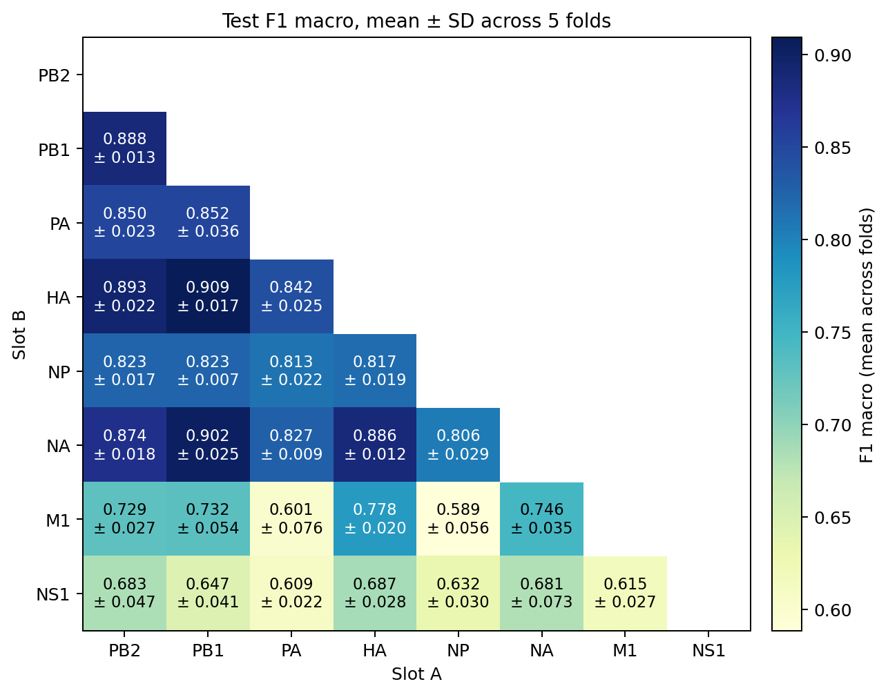

# Task 1 with aligned codon features, 28 schema pairs, Human-H3N2-2024

```yaml
# Provenance. status: current | at-risk (inputs changed, not rebuilt) | superseded (replaced)
status:         current
date:           2026-11-19
population:     Human-H3N2-2024
proteins:       PB2, PB1, PA, HA, NP, NA, M1, NS1
features:       per-site codons in protein-alignment columns (site.mode aligned), ordinal
model:          LightGBM, 5-fold CV
commit:         f5cc2f4
spec:           conf/experiments/human_h3n2_2024_28p_codon_aligned_matched_cv5.yaml
datasets:       data/datasets/flu/July_2025/runs/task1_28p_aligned_codon_matched_20261119_164751_*
training_run:   models/flu/July_2025/training_runs/task1_28p_aligned_codon_matched_20261119_164751_lgbm_20261119_165458/
report:         results/flu/July_2025/task1_28p_aligned_codon_matched_20261119_164751_report/
compared_with:  results/flu/July_2025/task1_28p_codon_matched_20261015_194607_report/ (pinned)
```

## Result

Task 1 was rerun with codons placed in protein-alignment columns instead of at pinned CDS
lengths. Everything else matched the pinned run. The dataset audit passed for all 28 datasets.

Over the 28 pairs, the mean test F1 macro was 0.769 with aligned features and 0.767 with pinned
features.

- 15 pairs gave identical scores. These are the pairs without PB1 or NS1. Their datasets are
  identical to the pinned ones, and so are their test predictions on every fold.
- The 13 pairs with PB1 or NS1 kept a few more records. The retention rule keeps PB1 at
  2,274 nt and NS1 at 660 nt, which the pins drop. For 12 of these pairs the F1 macro changed by
  less than one fold SD. PB1-NS1 dropped from 0.728 to 0.647.

Task 1 holds one subtype, so it shows that the aligned pipeline reproduces the pinned results. It
does not show that alignment helps. Alignment matters when different forms of a protein share a
population, such as H1, H3 and H5 or N1 and N2, so Task 2 is the test of that.


